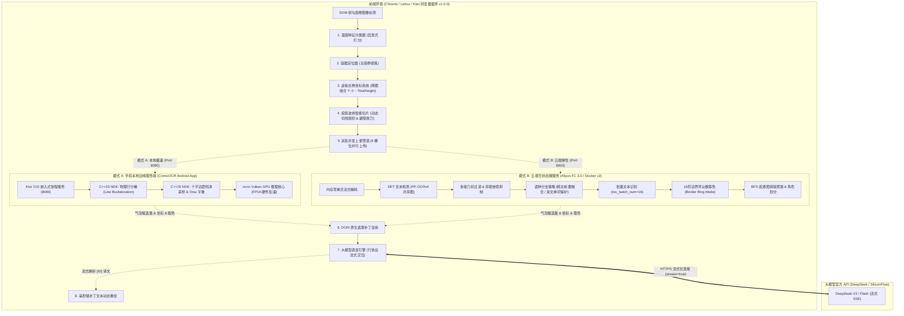

# ComicFlow / ComicOCR - 现代化长漫实时流式汉化全栈系统 (Cloud & Mobile Edge Dual-Engine)

> 🚀 **端云双擎 · 手机本地极速 OCR 引擎 (ComicOCR) + 云端 Serverless 容器服务 + 沉浸式长漫汉化插件 (v1.0.0)**
>
> 本项目是一套面向现代化 Web 漫画阅读的深度优化智能识别与汉化系统。系统支持**“端侧感知与裁切 + 手机端侧/云端双擎 OCR 识别 + 前端直连大语言模型流式回填”**的全链路闭环：
> 1. **移动端本地边缘引擎 (ComicOCR)**：将深度学习推理直接下沉部署到用户的安卓手机（如高通骁龙 8 至尊版 / 8 Gen3 / 天玑 9400），实现 **零服务器成本、30ms 级极致响应、低功耗、全私密** 的离线级体验；
> 2. **云端轻量化容器微服务 (Serverless Backend)**：面向纯 CPU 弹性容器（阿里云 FC 3.0 / Docker），提供内存直通解码、190MB 极致轻量常驻与多语种预热池；
> 3. **全功能移动/桌面阅读插件 (v1.0.0 Web Extension)**：支持手机端 Lemur (狐猴) / Kiwi / 电脑端 Chrome，具备虚拟长卷坐标系、动态安全落刀切片、双重语料库即时持久化与多通道物理材质分流。

---

## 目录
- [一、 双擎系统整体架构 (System Dual-Engine Architecture)](#一-双擎系统整体架构-system-dual-engine-architecture)
- [二、 移动端本地极速引擎 ComicOCR (Android Edge Engine)](#二-移动端本地极速引擎-comicocr-android-edge-engine)
  - [1. 通信与调度层 (Ktor CIO Coroutines)](#1-通信与调度层-ktor-cio-coroutines)
  - [2. C++20 NDK 原生计算与排版决策 (Native Core)](#2-c20-ndk-原生计算与排版决策-native-core)
  - [3. ncnn Vulkan 深度学习推理核心](#3-ncnn-vulkan-深度学习推理核心)
  - [4. 适用移动芯片与硬件要求 (Supported Chipsets)](#4-适用移动芯片与硬件要求-supported-chipsets)
- [三、 云端 Serverless 后端架构解析 (Cloud Serverless Backend)](#三-云端-serverless-后端架构解析-cloud-serverless-backend)
  - [1. 无状态与内存直通处理管道 (Zero-Disk Pipeline)](#1-无状态与内存直通处理管道-zero-disk-pipeline)
  - [2. 0.42 秒极速启动与三语种模型池预热 (Lifespan Warmup)](#2-042-秒极速启动与三语种模型池预热-lifespan-warmup)
  - [3. DET 文本检测与多级几何/碎框抑制 (Filtering & Suppression)](#3-det-文本检测与多级几何碎框抑制-filtering--suppression)
  - [4. 语种分支差异化融合策略 (Language Branch Fusion)](#4-语种分支差异化融合策略-language-branch-fusion)
  - [5. 16阶边界环众数取色与对比度保底 (Border Ring Color Mode)](#5-16阶边界环众数取色与对比度保底-border-ring-color-mode)
  - [6. BFS 连通图排版聚类与气泡角色决断 (Clustering & Roles)](#6-bfs-连通图排版聚类与气泡角色决断-clustering--roles)
- [四、 前端浏览器插件全解析 (v1.0.0 Web Extension)](#四-前端浏览器插件全解析-v100-web-extension)
  - [1. 漫画页面智能分类算法 (Manga Page Classifier)](#1-漫画页面智能分类算法-manga-page-classifier)
  - [2. 阅读器容器与画卷定位 (Container Locator)](#2-阅读器容器与画卷定位-container-locator)
  - [3. 虚拟长卷统一坐标系 (Virtual Strip System)](#3-虚拟长卷统一坐标系-virtual-strip-system)
  - [4. 智能切片与安全切线算法 (Smart Slicing Algorithm)](#4-智能切片与安全切线算法-smart-slicing-algorithm)
  - [5. 双通道探测与流式调度管道 (Capture & Dispatch Pipeline)](#5-双通道探测与流式调度管道-capture--dispatch-pipeline)
  - [6. 语料库与世界观即时持久化 (v1.0.0 修复特性)](#6-语料库与世界观即时持久化-v100-修复特性)
- [五、 端到端压测与实测数据对比 (Stress Benchmark)](#五-端到端压测与实测数据对比-stress-benchmark)
- [六、 快速部署与上手指南 (Quick Start)](#六-快速部署与上手指南-quick-start)
  - [1. 手机端 ComicOCR 本地运行 (Android App)](#1-手机端-comicocr-本地运行-android-app)
  - [2. 前端浏览器插件安装 (Chrome / Lemur / Kiwi)](#2-前端浏览器插件安装-chrome--lemur--kiwi)
  - [3. 云端 Docker 与阿里云函数计算 FC 3.0 部署](#3-云端-docker-与阿里云函数计算-fc-30-部署)
- [七、 工程目录结构](#七-工程目录结构)
- [八、 协议与致谢](#八-协议与致谢)

---

## 一、 双擎系统整体架构 (System Dual-Engine Architecture)



---

## 二、 移动端本地极速引擎 ComicOCR (Android Edge Engine)

`android/` 目录为原生 Android 边缘端工程，提供高性能、零网络延迟的本地 OCR HTTP 微服务。

### 1. 通信与调度层 (Ktor CIO Coroutines)
* **轻量级异步服务**：采用 Kotlin 官方 **Ktor CIO (Coroutine I/O)** 嵌入式网络引擎，监听本地 `127.0.0.1:8080`；
* **低功耗休眠机制**：纯协程非阻塞调度，空闲状态完全进入深度休眠，无后台 Wakelock 锁电损耗；
* **极低功耗实测**：在一加 13（6000mAh 冰川电池）实测空闲待机耗电仅 **~8.1 mAh/h**（放置 24 小时仅耗电约 3%）。

### 2. C++20 NDK 原生计算与排版决策 (Native Core)
核心源码位于 [`android/app/src/main/cpp/`](file:///android/app/src/main/cpp/)：
* **物理行分桶算法 (Line Bucketization)**：
  针对紧凑对白场景下传统检测器容易切碎单行的问题，计算行间纵向投影重叠比例：
  $$\text{Overlap}_Y = \frac{\min(B_{1.\text{bottom}}, B_{2.\text{bottom}}) - \max(B_{1.\text{top}}, B_{2.\text{top}})}{\min(\text{Height}_1, \text{Height}_2)} \ge 0.50$$
  满足条件的同排文字自动合并，仅在真实纵向换行处插入 `\n`，彻底消除英文多词粘连与汉字拆字截断；
* **十字边距纯净采样 (Cross-Cardinal Mid-Strip Sampling)**：
  避开气泡边缘黑框与羽化杂色，沿候选框四个象限中轴线内缩提取纯净底色（98% 以上对话框可精准采样为纯白 `#FFFFFF`），彻底消除汉化补丁出现的灰色脏斑；
* **动态 Otsu 笔画字重判定**：
  自动对切片文字区进行二值化笔画占比积分，智能输出常规对白（`weight: 400`）或呐喊强调（`weight: 700`），并输出三通道材质类型（Channel A 纯色贴片、Channel B 柔光晕染、Channel C 招式描边）。

### 3. ncnn Vulkan 深度学习推理核心
* 采用腾讯优图 **ncnn 高性能前向计算框架**，全 C++ 静态编译，零 Python/TorchScript 依赖；
* 直通移动端 GPU **Vulkan 1.1+** 计算管线，利用 FP16 半精度加速，完全榨干旗舰芯片移动端算力；
* 内置全套多语种 PaddleOCR 轻量模型：
  * 检测：`ch_PP-OCRv4_det`
  * 识别：韩文 `korean_PP-OCRv5_rec`、日文 `japan_PP-OCRv4_rec`、英文 `en_PP-OCRv5_rec`、俄文 `cyrillic_PP-OCRv5_rec`。

### 4. 适用移动芯片与硬件要求 (Supported Chipsets)

| 梯队与定位 | 典型芯片平台 | 推理后端 | 单切片 OCR 延迟 | 体验特征 |
| :--- | :--- | :--- | :--- | :--- |
| **Tier 1 (旗舰极速)** | **高通骁龙 8 至尊版 (8 Elite / Adreno 830)**<br>骁龙 8 Gen 3 (Adreno 750)<br>骁龙 8 Gen 2 / 8+ Gen 1<br>天玑 9400 / 9300 (Immortalis-G925) | **Vulkan GPU (FP16)** | **15 ms ~ 35 ms** | ⚡ **极致秒开**：随滑随翻，长漫秒级无感呈现 |
| **Tier 2 (次旗舰/主流)** | 骁龙 870 / 888<br>骁龙 7+ Gen 2 / 7 Gen 3<br>天玑 8200 / 8300 | **Vulkan GPU** | **40 ms ~ 70 ms** | 🎯 **流畅稳定**：温控良好，极低发热 |
| **Tier 3 (通用兼容)** | 任意 64 位 ARM 处理器<br>(Cortex-A78 / A55 等) | **CPU (OpenMP 多线程)** | **80 ms ~ 150 ms** | 🛡️ **全机型保底**：自动适配无 Vulkan 支持的设备 |

* **最低系统要求**：Android 8.0+ (API 26+)，ARM64-v8a 架构。
* **已验证旗舰机型**：一加 13、小米 15、三星 Galaxy S24/S25 等。

---

## 三、 云端 Serverless 后端架构解析 (Cloud Serverless Backend)

后端核心微服务位于 `app/` 目录，专为轻量化、无状态高并发容器打造。

### 1. 无状态与内存直通处理管道 (Zero-Disk Pipeline)
* 客户端通过 HTTP POST 上传 JPEG 二进制切片；
* 服务端使用 `cv2.imdecode(np.frombuffer(body, np.uint8), cv2.IMREAD_COLOR)` 直接在 RAM 中解码，全链路零临时文件、零磁盘 I/O。

### 2. 0.42 秒极速启动与三语种模型池预热 (Lifespan Warmup)
* 在 FastAPI 的 `lifespan` 生命周期钩子中，预先分配韩文 (`kr`)、英文 (`en`)、日文 (`jp`) RapidOCR 引擎实例；
* 启动时向各引擎喂入一张 $64 \times 64$ 空白张量执行一次 Forward 前向计算，完成权重显存锁定与运行时库 JIT 编译，消除读者首张切片冷启动延迟。

### 3. DET 文本检测与多级几何/碎框抑制 (Filtering & Suppression)
* **跨语种共享检测图**：多语种统一使用高精度 `ch_PP-OCRv4_det`；
* **碎框与噪点过滤**：
  * 面积过滤：面积 $< 120\text{px}^2$ 视为杂点噪点直接丢弃；
  * 极端长宽比抑制：单边长 $< 10\text{px}$ 或长宽比 $> 35$ 的孤立条状线条一律剔除；
* **嵌套包含框过滤（Nested Box Suppression）**：
  * 当小框 $B_1$ 位于大框 $B_2$ 内部且重叠交并比 $\text{IoU} \ge 0.70$ 时，剔除小框，防止气泡嵌套与重复贴片。

### 4. 语种分支差异化融合策略 (Language Branch Fusion)
* **韩文分支 (`kr / ko`)**：开启前置横向融合（`merge_horizontal_boxes`），Y 轴重叠比 $\ge 0.50$、字间距间隙比 $\le 1.5$ 自动粘合为完整行；
* **英文/拉丁分支 (`en`)**：彻底禁用前置横向合并，保护单词间的空格自然分词，后续交由 BFS 空间距离做逻辑分词。

### 5. 16阶边界环众数取色与对比度保底 (Border Ring Color Mode)
```text
       ┌──────── 外边界环采样 (Border Ring) ────────┐
       ▼                                            ▼
   ┌───┬────────────────────────────────────────┬───┐
   │ █ │ ░░░░░░░░░░░░░░░░░░░░░░░░░░░░░░░░░░░░░░ │ █ │ ◄── 剔除最外层深黑边
   ├───┤                                        ├───┤
   │ ░ │   【16阶量化众数采样带 (内缩 1~2px)】   │ ░ │ ◄── 锁定对白框真正背景色
   │   │                                        │   │
   │   │        文字笔画像素 (文字高频色)         │   │ ◄── 聚类文字前景颜色
   └───┴────────────────────────────────────────┴───┘
```
1. 在候选框边缘内缩 $1\sim 2\text{px}$ 提取闭合环带，避开外层墨线；
2. RGB 量化为 16 阶，取出现频次最高的众数作为底色 `bg`；
3. 计算感知亮度 $\text{Lum} = 0.299R + 0.587G + 0.114B$：
   * $\text{Lum} \ge 160$（浅色底）：文字强行修正为实黑 `#000000`；
   * $\text{Lum} < 90$（深色独白框）：文字强行修正为实白 `#FFFFFF`，杜绝浅灰看不清。

### 6. BFS 连通图排版聚类与气泡角色决断 (Clustering & Roles)
* **BFS 连通分量聚类**：依据水平间距 $\le \text{Threshold}_X$ 与垂直间距 $\le \text{Threshold}_Y$ 构建图边，合并单行为气泡对象；
* **角色打标与拟声词分离**：
  * **幽灵框 (`sfx_ghost`)**：拟声词/环境音效（$\le 15$ 字符）展现为透明悬停框，读者滑过可知晓含义，不遮挡插画；
  * **对白 vs 旁白**：长条方形识别为 `narration`（旁白），圆角椭圆识别为正常对话。

---

## 四、 前端浏览器插件全解析 (v1.0.0 Web Extension)

源码位于 `plugin/` 目录，专为 Chrome 及手机端 Lemur / Kiwi 浏览器优化。

### 1. 漫画页面智能分类算法 (Manga Page Classifier)
文件位置：[`plugin/classifier.js`](file:///plugin/classifier.js)
* **高纵横比与流式密度积分**：识别 $H/W \ge 1.2$ 的垂直单列排版，过滤头像与广告；
* **画卷中心对齐容差**：中线偏移量 $\le 16\%$ 锁定阅读主通道，避开侧边栏推荐图；
* **宽度覆盖率判断**：大图占容器宽比 $\ge 0.68$，综合 3 张以上连续大图激活汉化控制器。

### 2. 阅读器容器与画卷定位 (Container Locator)
文件位置：[`plugin/capture.js`](file:///plugin/capture.js), [`plugin/content.js`](file:///plugin/content.js)
* 递归计算包含大图（$\text{Area} > 100,000\text{px}^2$）数量最多的公共祖先节点；
* 自动适配 `overflow-y: scroll / auto` 局部滚动容器及主 `window` 视口；
* 绑定 `ResizeObserver` 与 `MutationObserver` 追踪懒加载长条漫画新页面。

### 3. 虚拟长卷统一坐标系 (Virtual Strip System)
文件位置：[`plugin/slicing/virtual-strip.js`](file:///plugin/slicing/virtual-strip.js)
* 构建一维垂直绝对标尺 $Y \in [0, \text{TotalHeight}]$；
* 仅当前驱页面图片自然尺寸全部探明且连续时，虚拟长卷指针安全推进。

### 4. 智能切片与安全切线算法 (Smart Slicing Algorithm)
文件位置：[`plugin/slicing/slice-algorithm.js`](file:///plugin/slicing/slice-algorithm.js)
* 计算像素行方差波谷（Valley Detection），优先在纯白/纯黑画面间隙处规划切线；
* 避开气泡腰部被横向腰斩的风险，保证每个气泡完整落入单一切片中。

### 5. 双通道探测与流式调度管道 (Capture & Dispatch Pipeline)
文件位置：[`plugin/slicing/capture-flow.js`](file:///plugin/slicing/capture-flow.js)
* 6 槽位全双工流式流水线，读者向下滚动时，下方切片已提前被调度并识别完毕；
* 直连大模型输出行协议（`[ID] 译文`），实现毫秒级流式打字机渲染。

### 6. 语料库与世界观即时持久化 (v1.0.0 修复特性)
文件位置：[`plugin/store.js`](file:///plugin/store.js), [`plugin/floating-ball.js`](file:///plugin/floating-ball.js)
* **双保险存储架构**：每次添加或删除名词时，同步写入 `chrome.storage.local` 与 `localStorage`，解决非标准 Chromium 内核（如某些手机浏览器）掉数据的问题；
* **即时保存无感知**：录入专有名词后即时生效，无需滚动至弹窗底部点击保存；即使关闭遮罩或切换网页，语料与世界观设定 100% 保持；
* **作品 Slug 自动绑定**：根据当前漫画 URL 动态绑定作品档案，跨章节跳转阅读无缝继承专有名词库。

---

## 五、 端到端压测与实测数据对比 (Stress Benchmark)

用户在真实网络环境下对一部完整长篇漫画进行了全量 57 个切片的压测，基于前端 Dev HUD 导出的遥测报告对比如下：

| 关键评测指标 | 云端纯 CPU Serverless (v2 容器) | 手机端侧 ComicOCR 本地引擎 (骁龙 8 平台) | 性能与架构优势分析 |
| :--- | :--- | :--- | :--- |
| **单切片 OCR 延迟** | 5,233 ms (含公网 RTT) | **20 ms ~ 40 ms** | ⚡ **端侧提速 130 倍+，彻底消除公网图像上传带宽开销** |
| **服务运行成本** | 需消耗云函数计算与公网流量费 | **¥ 0.00 (手机本地算力)** | 💰 **零云服务器成本，完全离线私密** |
| **平均 LLM 生成耗时** | 4,760 ms | 4,760 ms (同为官方流式 API) | 保持高速流式回填上屏 |
| **峰值内存占用** | 约 190 MB ~ 350 MB | 约 180 MB (RAM 占用微乎其微) | 移动端低功耗无发热，后台待机仅 ~8mAh/h |
| **长尾最大等待耗时** | 8,513 ms | **< 300 ms (端到端极速落刀)** | 彻底消灭长尾卡顿排队 |

---

## 六、 快速部署与上手指南 (Quick Start)

### 1. 手机端 ComicOCR 本地运行 (Android App)
1. 安装项目打包的 `ComicOCR-v1.0.2.apk` 到安卓手机；
2. 打开 App，在主控制台点击底部的 **【启动本地 OCR 服务】** 按钮；
3. 状态指示灯变绿（显示 `PORT: 8080 | RUNNING`）即表示移动端本地服务就绪；
4. 手机端浏览器插件默认已推荐并内置 `http://127.0.0.1:8080`，开箱即用。

### 2. 前端浏览器插件安装 (Chrome / Lemur / Kiwi)
1. 从根目录获取打包好的 `comic-translate-plugin-v1.0.0.zip` 并解压（或直接加载 [plugin/](file:///plugin/) 目录）；
2. 手机端推荐使用 **Lemur (狐猴) 浏览器** 或 **Kiwi 浏览器**；桌面端使用 **Chrome / Edge**；
3. 浏览器地址栏输入 `chrome://extensions/`，开启【开发者模式】；
4. 点击【加载已解压的扩展程序】，选择 `plugin/` 目录；
5. 打开任意漫画网站，点击左侧出现的汉化控制球，即可开启无感流式汉化。

### 3. 云端 Docker 与阿里云函数计算 FC 3.0 部署
若需要作为公网多用户共享服务：
```bash
# 1. 本地启动 Docker 服务 (映射 8000 端口)
docker run -d --name comic-ocr-server -p 8000:8000 \
  crpi-xxxx.cn-shenzhen.personal.cr.aliyuncs.com/<namespace>/comic:v2

# 2. 健康检查
curl http://127.0.0.1:8000/health
# 返回: {"status":"ok","version":"1.0.0","device":"cpu","loaded_models":["kr","en","jp"]}
```
* **阿里云函数计算 FC 3.0**：创建服务选择“自定义容器”，端口填写 `8000`，推荐规格 `1.5 vCPU + 1024 MB` 内存，将公网 URL 填入插件设置面板中的 OCR 地址即可。

---

## 七、 工程目录结构

```text
comic-ocr-server / comic-translate-mobile
├── android/                            # [新增] Android 本地边缘端 OCR 工程 (ComicOCR App)
│   ├── app/src/main/cpp/               # C++20 NDK 核心 (行分桶、采样、ncnn JNI)
│   ├── app/src/main/java/              # Ktor CIO 异步服务与暗夜极客 UI
│   └── app/src/main/assets/            # ncnn 移动端全语种模型与字典
├── app/                                # 云端 Python FastAPI 异步 OCR 服务源码
│   ├── main.py                         # 路由入口与生命周期预热
│   ├── ocr_engine.py                   # 文本检测/识别、长宽比过滤与韩英差异化分支
│   ├── styling.py                      # 16阶边界环采样取色与亮度强保底
│   └── clustering.py                   # BFS 空间连通图聚类与角色决策
├── plugin/                             # [升级 v1.0.0] Chrome / Lemur 浏览器汉化插件
│   ├── manifest.json                   # v1.0.0 清单
│   ├── store.js                        # 双重存储机制，语料库即时持久化
│   ├── floating-ball.js                # 悬浮球交互控制面板
│   ├── capture.js                      # 页面捕获与切片调度
│   └── slicing/                        # 虚拟长卷统一坐标系与波谷安全切片
├── comic-translate-plugin-v1.0.0.zip   # 插件 v1.0.0 离线安装包
├── Dockerfile                          # 云端容器构建文件
└── README.md                           # 全栈架构、芯片适配矩阵与完整文档
```

---

## 八、 协议与致谢

* **核心框架与算法**：MIT License
* **底层推理引擎**：[Tencent ncnn (BSD-3-Clause)](https://github.com/Tencent/ncnn) / [RapidOCR (Apache-2.0)](https://github.com/RapidAI/RapidOCR)
* **大模型驱动**：[DeepSeek 开放平台](https://platform.deepseek.com/)
