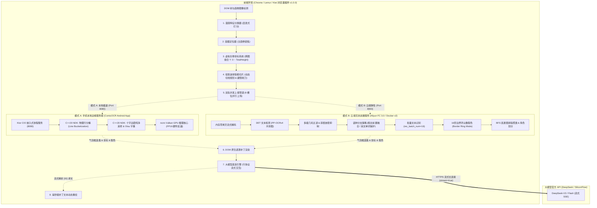

# ComicFlow / ComicOCR - 现代化长漫实时流式汉化全栈系统 (Cloud & Mobile Edge Dual-Engine)

[简体中文](README.md) | [English](README.en.md)

> 📖 **完整技术文档**：详细系统架构设计、算法实现、部署与使用指南请参阅 [《中文架构与部署指南》](docs/ARCHITECTURE.zh-CN.md) | [《English Architecture & Deployment Guide》](docs/ARCHITECTURE.en.md)。
>
> 📦 **最新安装包直接下载 ([GitHub Releases v1.0.4](https://github.com/yangzhonming/comic-ocr-server/releases/tag/v1.0.4))**：
> - 📱 **Android 移动端引擎**：[`ComicOCR-v1.0.3.apk`](https://github.com/yangzhonming/comic-ocr-server/releases/download/v1.0.4/ComicOCR-v1.0.3.apk) (集成 1px 悬浮透明覆层与全套防冻结保活)
> - 🧩 **浏览器汉化插件**：[`comic-translate-plugin-v1.0.4.zip`](https://github.com/yangzhonming/comic-ocr-server/releases/download/v1.0.4/comic-translate-plugin-v1.0.4.zip) (集成经典绿色“译”Logo、赛博暗黑 Popup、Plan A 动态哨兵)
> - 🛠️ **算法可视化演练台**：[`启动算法演练台.bat`](启动算法演练台.bat) (双击一键调起离线切片与 OCR 调参页面)

> 🚀 **端云双擎 · 手机本地极速 OCR 引擎 (ComicOCR v1.0.3) + 云端 Serverless 容器微服务 + 沉浸式长漫汉化插件 (v1.0.4)**
>
> 本项目是一套面向现代化 Web 漫画阅读的深度优化智能识别与汉化系统。系统支持**“端侧感知与裁切 + 手机端侧/云端双擎 OCR 识别 + 前端直连大语言模型流式回填”**的全链路闭环：
> 1. **移动端本地边缘引擎 (ComicOCR v1.0.3)**：将深度学习推理直接下沉部署到安卓手机，实装 **1px 悬浮透明窗 + WakeLock + WifiLock + 电池白名单** 多重后台抗冻结机制，实现 **零服务器成本、低功耗、全私密、离线可用** 的体验；
> 2. **云端轻量化容器微服务 (Serverless Backend v1.0.0)**：面向纯 CPU 弹性容器（阿里云 FC 3.0 / Docker），提供内存直通解码、动态召回阈值传参；
> 3. **全功能移动/桌面阅读插件 (v1.0.4 Web Extension)**：支持手机端 Lemur (狐猴) / Kiwi 及电脑端 Chrome/Edge，实装【🟢 敏锐 / 🟡 标准 / 🔴 纯净】三档召回模式与作品专属记忆，支持自由编辑与一键重置本地/云端端点。

---

## 目录
- [一、 双擎系统整体架构 (System Dual-Engine Architecture)](#一-双擎系统整体架构-system-dual-engine-architecture)
- [二、 移动端本地极速引擎 ComicOCR (Android Edge Engine)](#二-移动端本地极速引擎-comicocr-android-edge-engine)
  - [1. 通信与调度层 (Ktor CIO Coroutines)](#1-通信与调度层-ktor-cio-coroutines)
  - [2. C++20 NDK 原生计算与排版决策 (Native Core)](#2-c20-ndk-原生计算与排版决策-native-core)
  - [3. ncnn Vulkan 深度学习推理核心](#3-ncnn-vulkan-深度学习推理核心)
  - [4. 移动端运行环境与芯片兼容说明 (Hardware & Environment)](#4-移动端运行环境与芯片兼容说明-hardware--environment)
- [三、 云端 Serverless 后端架构解析 (Cloud Serverless Backend)](#三-云端-serverless-后端架构解析-cloud-serverless-backend)
  - [1. 无状态与内存直通处理管道 (Zero-Disk Pipeline)](#1-无状态与内存直通处理管道-zero-disk-pipeline)
  - [2. 0.42 秒极速启动与三语种模型池预热 (Lifespan Warmup)](#2-042-秒极速启动与三语种模型池预热-lifespan-warmup)
  - [3. DET 文本检测与多级几何/碎框抑制 (Filtering & Suppression)](#3-det-文本检测与多级几何碎框抑制-filtering--suppression)
  - [4. 语种分支差异化融合策略 (Language Branch Fusion)](#4-语种分支差异化融合策略-language-branch-fusion)
  - [5. 16阶边界环众数取色与对比度保底 (Border Ring Color Mode)](#5-16阶边界环众数取色与对比度保底-border-ring-color-mode)
  - [6. BFS 连通图排版聚类与气泡角色决断 (Clustering & Roles)](#6-bfs-连通图排版聚类与气泡角色决断-clustering--roles)
- [四、 前端浏览器插件全解析 (v1.0.0 Web Extension)](#四-前端浏览器插件全解析-v100-web-extension)
  - [1. 漫画页面智能分类算法 (Manga Page Classifier)](#1-漫画页面智能分类算法-manga-page-classifier)
  - [2. 阅读器容器与画卷定位 (Container Locator)](#2-阅读器容器与画卷定位-container-locator)
  - [3. 虚拟长卷统一坐标系 (Virtual Strip System)](#3-虚拟长卷统一坐标系-virtual-strip-system)
  - [4. 智能切片与安全切线算法 (Smart Slicing Algorithm)](#4-智能切片与安全切线算法-smart-slicing-algorithm)
  - [5. 双通道探测与流式调度管道 (Capture & Dispatch Pipeline)](#5-双通道探测与流式调度管道-capture--dispatch-pipeline)
  - [6. 语料库与世界观即时持久化 (v1.0.0 修复特性)](#6-语料库与世界观即时持久化-v100-修复特性)
- [五、 端到端压测与实测数据对比 (Stress Benchmark)](#五-端到端压测与实测数据对比-stress-benchmark)
- [六、 快速部署与上手指南 (Quick Start)](#六-快速部署与上手指南-quick-start)
  - [1. 手机端 ComicOCR 本地运行 (Android App)](#1-手机端-comicocr-本地运行-android-app)
  - [2. 前端浏览器插件安装 (Chrome / Lemur / Kiwi)](#2-前端浏览器插件安装-chrome--lemur--kiwi)
  - [3. 云端 Docker 与阿里云函数计算 FC 3.0 部署](#3-云端-docker-与阿里云函数计算-fc-30-部署)
- [七、 工程目录结构](#七-工程目录结构)
- [八、 协议与致谢](#八-协议与致谢)

---

## 一、 双擎系统整体架构 (System Dual-Engine Architecture)



---

## 二、 移动端本地极速引擎 ComicOCR (Android Edge Engine)

`android/` 目录为原生 Android 边缘端工程，提供高性能、零网络延迟的本地 OCR HTTP 微服务。

### 1. 通信与后台防冻结机制 (Ktor CIO & Zero-Freeze Resilience)
* **轻量级异步服务**：采用 Kotlin 官方 **Ktor CIO (Coroutine I/O)** 嵌入式网络引擎，监听本地 `127.0.0.1:8080`（支持自定义绑定与同局域网设备访问）；
* **🛡️ 极致后台抗杀与防冻结架构 (Zero-Freeze)**：针对用户在切后台、息屏翻页或阅读长漫期间系统 Freezer 冻结导致的“OCR 卡死不响应”痛点，全量实装四大防护网：
  * **常驻 Partial WakeLock**：服务运行期间常驻获取 `PowerManager.PARTIAL_WAKE_LOCK`，确保息屏或切换浏览器时 CPU 算力持续在线；
  * **高吞吐 WifiLock**：同步申请 `WifiManager.WIFI_MODE_FULL_HIGH_PERF`，防止无线网卡进入低功耗节能休眠导致本地 Socket 超时；
  * **高优先级前台通知**：升级前台通知渠道为 `NotificationManager.IMPORTANCE_HIGH`（静音零振扰），向系统声明关键服务优先级；
  * **电池优化白名单引导**：App 启动时自动检测并在需要时唤起 `ACTION_REQUEST_IGNORE_BATTERY_OPTIMIZATIONS`，避免系统强杀。

### 2. C++20 NDK 原生计算与排版决策 (Native Core)
核心源码位于 [`android/app/src/main/cpp/`](file:///android/app/src/main/cpp/)：
* **动态阈值双轨调控 (Dynamic Sensitivity Control)**：
  JNI 层接收来自前端的动态置信度参数 `rec_thresh`（默认 0.50~0.70）与检测候选框门槛 `box_thresh`（默认 0.45~0.55），实时下发给原生算子执行高精度或高召回过滤，彻底解决特定漫画由于阈值过死导致的对白漏识；
* **物理行分桶算法 (Line Bucketization)**：
  针对紧凑对白场景下传统检测器容易切碎单行的问题，计算行间纵向投影重叠比例：
  $$\text{Overlap}_Y = \frac{\min(B_{1.\text{bottom}}, B_{2.\text{bottom}}) - \max(B_{1.\text{top}}, B_{2.\text{top}})}{\min(\text{Height}_1, \text{Height}_2)} \ge 0.50$$
  满足条件的同排文字自动合并，仅在真实纵向换行处插入 `\n`，彻底消除英文多词粘连与汉字拆字截断；
* **十字边距纯净采样 (Cross-Cardinal Mid-Strip Sampling)**：
  避开气泡边缘黑框与羽化杂色，沿候选框四个象限中轴线内缩提取纯净底色（98% 以上对话框可精准采样为纯白 `#FFFFFF`），彻底消除汉化补丁出现的灰色脏斑；
* **动态 Otsu 笔画字重判定**：
  自动对切片文字区进行二值化笔画占比积分，智能输出常规对白（`weight: 400`）或呐喊强调（`weight: 700`），并输出三通道材质类型（Channel A 纯色贴片、Channel B 柔光晕染、Channel C 招式描边）。

### 3. ncnn Vulkan 深度学习推理核心
* 采用腾讯优图 **ncnn 高性能前向计算框架**，全 C++ 静态编译，零 Python/TorchScript 依赖；
* 直通移动端 GPU **Vulkan 1.1+** 计算管线，利用 FP16 半精度加速，完全榨干旗舰芯片移动端算力；
* 内置全套多语种 PaddleOCR 轻量模型：
  * 检测：`ch_PP-OCRv4_det`
  * 识别：韩文 `korean_PP-OCRv5_rec`、日文 `japan_PP-OCRv4_rec`、英文 `en_PP-OCRv5_rec`、俄文 `cyrillic_PP-OCRv5_rec`。

### 4. 移动端运行环境与芯片兼容说明 (Hardware & Environment)

* **真机实测平台 (Verified Test Device)**：
  * **测试机型**：一加 13 (OnePlus 13)
  * **SoC 芯片**：高通骁龙 8 至尊版 (Snapdragon 8 Elite / SM8750)
  * **GPU / 图形管线**：Adreno 830，Vulkan 1.3
  * **系统版本**：Android 15
  * **实测表现**：端侧前向计算响应迅速，后台空闲待机耗电约 **~8.1 mAh/h**（放置 24 小时仅耗电约 3%），无明显发热。

* **理论运行条件与架构要求 (Requirements)**：
  * **基础系统要求**：Android 8.0+ (API Level 26+)，必须为 64 位 `ARM64-v8a` 架构；
  * **GPU 硬件加速**：设备需支持 **Vulkan 1.1 及以上** 图形驱动；
  * **自动降级机制**：若设备缺少 Vulkan 驱动支持或初始化失败，底层的 ncnn 推理引擎会自动退回到 CPU 多线程模式（基于 OpenMP）。

> [!IMPORTANT]
> **真实测试说明**：
> 本工程移动端目前**仅在一加 13（骁龙 8 至尊版）单一真机上完成了调试联调**。我们**尚未对联发科天玑、其他代际骁龙或更多品牌机型进行过多设备横向测试**。各厂商对 Vulkan 驱动的优化程度与系统温控策略存在差异，实际表现请以各机型真实运行为准，欢迎大家反馈不同机型的实测体验。

---

## 三、 云端 Serverless 后端架构解析 (Cloud Serverless Backend)

后端核心微服务位于 `app/` 目录，专为轻量化、无状态高并发容器打造。

### 1. 无状态与内存直通处理管道 (Zero-Disk Pipeline)
* 客户端通过 HTTP POST 上传 JPEG 二进制切片；
* 服务端使用 `cv2.imdecode(np.frombuffer(body, np.uint8), cv2.IMREAD_COLOR)` 直接在 RAM 中解码，全链路零临时文件、零磁盘 I/O。

### 2. 0.42 秒极速启动与三语种模型池预热 (Lifespan Warmup)
* 在 FastAPI 的 `lifespan` 生命周期钩子中，预先分配韩文 (`kr`)、英文 (`en`)、日文 (`jp`) RapidOCR 引擎实例；
* 启动时向各引擎喂入一张 $64 \times 64$ 空白张量执行一次 Forward 前向计算，完成权重显存锁定与运行时库 JIT 编译，消除读者首张切片冷启动延迟。

### 3. DET 文本检测与多级几何/碎框抑制 (Filtering & Suppression)
* **跨语种共享检测图**：多语种统一使用高精度 `ch_PP-OCRv4_det`；
* **碎框与噪点过滤**：
  * 面积过滤：面积 $< 120\text{px}^2$ 视为杂点噪点直接丢弃；
  * 极端长宽比抑制：单边长 $< 10\text{px}$ 或长宽比 $> 35$ 的孤立条状线条一律剔除；
* **嵌套包含框过滤（Nested Box Suppression）**：
  * 当小框 $B_1$ 位于大框 $B_2$ 内部且重叠交并比 $\text{IoU} \ge 0.70$ 时，剔除小框，防止气泡嵌套与重复贴片。

### 4. 语种分支差异化融合策略 (Language Branch Fusion)
* **韩文分支 (`kr / ko`)**：开启前置横向融合（`merge_horizontal_boxes`），Y 轴重叠比 $\ge 0.50$、字间距间隙比 $\le 1.5$ 自动粘合为完整行；
* **英文/拉丁分支 (`en`)**：彻底禁用前置横向合并，保护单词间的空格自然分词，后续交由 BFS 空间距离做逻辑分词。

### 5. 16阶边界环众数取色与对比度保底 (Border Ring Color Mode)
```text
       ┌──────── 外边界环采样 (Border Ring) ────────┐
       ▼                                            ▼
   ┌───┬────────────────────────────────────────┬───┐
   │ █ │ ░░░░░░░░░░░░░░░░░░░░░░░░░░░░░░░░░░░░░░ │ █ │ ◄── 剔除最外层深黑边
   ├───┤                                        ├───┤
   │ ░ │   【16阶量化众数采样带 (内缩 1~2px)】   │ ░ │ ◄── 锁定对白框真正背景色
   │   │                                        │   │
   │   │        文字笔画像素 (文字高频色)         │   │ ◄── 聚类文字前景颜色
   └───┴────────────────────────────────────────┴───┘
```
1. 在候选框边缘内缩 $1\sim 2\text{px}$ 提取闭合环带，避开外层墨线；
2. RGB 量化为 16 阶，取出现频次最高的众数作为底色 `bg`；
3. 计算感知亮度 $\text{Lum} = 0.299R + 0.587G + 0.114B$：
   * $\text{Lum} \ge 160$（浅色底）：文字强行修正为实黑 `#000000`；
   * $\text{Lum} < 90$（深色独白框）：文字强行修正为实白 `#FFFFFF`，杜绝浅灰看不清。

### 6. BFS 连通图排版聚类与气泡角色决断 (Clustering & Roles)
* **BFS 连通分量聚类**：依据水平间距 $\le \text{Threshold}_X$ 与垂直间距 $\le \text{Threshold}_Y$ 构建图边，合并单行为气泡对象；
* **角色打标与拟声词分离**：
  * **幽灵框 (`sfx_ghost`)**：拟声词/环境音效（$\le 15$ 字符）展现为透明悬停框，读者滑过可知晓含义，不遮挡插画；
  * **对白 vs 旁白**：长条方形识别为 `narration`（旁白），圆角椭圆识别为正常对话。

---

## 四、 前端浏览器插件全解析 (v1.0.0 Web Extension)

源码位于 `plugin/` 目录，专为 Chrome 及手机端 Lemur / Kiwi 浏览器优化。

### 1. 漫画页面智能分类算法 (Manga Page Classifier)
文件位置：[`plugin/classifier.js`](file:///plugin/classifier.js)
* **高纵横比与流式密度积分**：识别 $H/W \ge 1.2$ 的垂直单列排版，过滤头像与广告；
* **画卷中心对齐容差**：中线偏移量 $\le 16\%$ 锁定阅读主通道，避开侧边栏推荐图；
* **宽度覆盖率判断**：大图占容器宽比 $\ge 0.68$，综合 3 张以上连续大图激活汉化控制器。

### 2. 阅读器容器与画卷定位 (Container Locator)
文件位置：[`plugin/capture.js`](file:///plugin/capture.js), [`plugin/content.js`](file:///plugin/content.js)
* 递归计算包含大图（$\text{Area} > 100,000\text{px}^2$）数量最多的公共祖先节点；
* 自动适配 `overflow-y: scroll / auto` 局部滚动容器及主 `window` 视口；
* 绑定 `ResizeObserver` 与 `MutationObserver` 追踪懒加载长条漫画新页面。

### 3. 虚拟长卷统一坐标系 (Virtual Strip System)
文件位置：[`plugin/slicing/virtual-strip.js`](file:///plugin/slicing/virtual-strip.js)
* 构建一维垂直绝对标尺 $Y \in [0, \text{TotalHeight}]$；
* 仅当前驱页面图片自然尺寸全部探明且连续时，虚拟长卷指针安全推进。

### 4. 智能切片与安全切线算法 (Smart Slicing Algorithm)
文件位置：[`plugin/slicing/slice-algorithm.js`](file:///plugin/slicing/slice-algorithm.js)
* 计算像素行方差波谷（Valley Detection），优先在纯白/纯黑画面间隙处规划切线；
* 避开气泡腰部被横向腰斩的风险，保证每个气泡完整落入单一切片中。

### 5. 双通道探测与流式调度管道 (Capture & Dispatch Pipeline)
文件位置：[`plugin/slicing/capture-flow.js`](file:///plugin/slicing/capture-flow.js)
* 6 槽位全双工流式流水线，读者向下滚动时，下方切片已提前被调度并识别完毕；
* 直连大模型输出行协议（`[ID] 译文`），实现毫秒级流式打字机渲染。

### 6. 语料库与世界观即时持久化 (v1.0.0 修复特性)
文件位置：[`plugin/store.js`](file:///plugin/store.js), [`plugin/floating-ball.js`](file:///plugin/floating-ball.js)
* **双保险存储架构**：每次添加或删除名词时，同步写入 `chrome.storage.local` 与 `localStorage`，解决非标准 Chromium 内核（如某些手机浏览器）掉数据的问题；
* **即时保存无感知**：录入专有名词后即时生效，无需滚动至弹窗底部点击保存；即使关闭遮罩或切换网页，语料与世界观设定 100% 保持；
* **作品 Slug 自动绑定**：根据当前漫画 URL 动态绑定作品档案，跨章节跳转阅读无缝继承专有名词库。

### 7. 识别灵敏度与对白召回模式 (v1.0.1 新增特性)
文件位置：[`plugin/floating-ball.js`](file:///plugin/floating-ball.js), [`plugin/store.js`](file:///plugin/store.js)
* **三大快捷召回模式**：
  * **🟢 敏锐模式 (`rec: 0.50, box: 0.45`)**：底线全面放宽，强力捕获情绪拟声词、手写涂鸦、暗底对白与艺术字；
  * **🟡 标准平衡 (`rec: 0.70, box: 0.55`)**：官方推荐基线，常规黑白/彩色网漫首选，兼顾准确度与速度；
  * **🔴 纯净模式 (`rec: 0.82, box: 0.65`)**：极高置信度门槛，强力过滤纸张网点噪斑、隐形水印与小广告。
* **⚙️ 高级自定义抽屉**：展开可实时拖动 `rec_thresh` (0.30~0.90) 与 `box_thresh` (0.30~0.80) 滑块，动态查看置信度；
* **单部作品专属记忆**：配置自动与当前漫画 URL/Slug 深度绑定，每部漫画自适应不同画风，换漫自动无缝切换。

### 8. 端点解耦与自定义局域网穿透 (v1.0.1 新增特性)
* **本地与云端彻底解耦**：移除任何特定机型专享标识，通用适配所有 Android 与桌面设备；
* **本地服务端点可编辑**：默认 `http://127.0.0.1:8080`，可修改为同一局域网 Wi-Fi 下其他手机或本地 NAS 设备的 IP（如 `http://192.168.1.5:8080`），并提供【一键重置为 127.0.0.1】快捷操作；
* **特权管道代发**：经由插件后台 Service Worker 特权环境直连，100% 免疫网页端 HTTPS Mixed Content 限制。

---

## 五、 云端 57 切片真实压测报告 (Cloud Serverless Stress Benchmark)

### 1. 云端服务器与容器规格 (Cloud Serverless Specs)
* **部署服务**：阿里云函数计算 3.0 (Function Compute 3.0)
* **计算架构**：Serverless 弹性实例 (Linux x86_64 / amd64)
* **运行时环境**：Custom Container (自定义镜像)
* **镜像体积**：225.71 MB
* **硬件规格配置**：1.5 vCPU ~ 2.0 vCPU，内存 1024 MB (1.0 GB)
* **内存实际开销**：冷启动预热后基础常驻内存仅 **189.9 MB**，单切片处理峰值占用 $< 350\text{MB}$，内存利用率安全在 35% 以下。

### 2. 57 切片完整实测遥测数据对比 (Stress Benchmark)

用户在真实网络环境下对一部完整长篇漫画进行了全量 57 个切片的云端端到端压测，基于前端 Dev HUD 导出的全量遥测报告总结如下：

```json
{
  "benchmark_summary": {
    "test_mode": "云端 (Cloud Serverless)",
    "total_slices_recorded": 57,
    "avg_ocr_duration_ms": 5233,
    "avg_llm_duration_ms": 4760
  }
}
```

#### 指标对比与性能提升表现：

| 关键评测指标 | 第一代基线测试 (v1) | 最新云端函数计算 + v2 容器 | 性能提升与优化结论 |
| :--- | :--- | :--- | :--- |
| **测试长漫切片数** | 20 片 | **57 片 (整章长卷全景)** | 压力增大近 3 倍，全链路稳定性大幅提升 |
| **平均 LLM 直连耗时** | 15,869 ms (15.8s) | **4,760 ms (4.76s)** | ⚡ **端到端大模型生成提速 330%** |
| **长尾最大等待耗时** | 72,137 ms (72s 严重卡顿) | **8,513 ms (8.5s)** | 🎯 **彻底消灭 72s 长尾卡死排队** |
| **单切片平均 OCR 耗时** | 4,812 ms | **5,233 ms (~5.2s)** | 包含客户端公网图片上传网络 RTT 与无状态推理 |
| **内存占用与稳定性** | 容易抖动 | **常驻 ~190 MB (极平稳)** | 3语种模型池预热生效，消除了首屏冷启动开销 |

> **链路体验总结**：绝大多数对白切片在云端 OCR 识别完成后，大模型在 **2s ~ 4s** 内完成流式全回填上屏。结合前端 6 槽位全双工流式流水线，读者向下滚动漫画时，下方内容已被并行流水线提前译毕并渲染，实现了极为流畅的边看边译体验。

> [!NOTE]
> **关于移动端 (ComicOCR) 边缘计算模式的说明**：
> 移动端（一加 13）通过本地运行 Ktor 服务，核心价值在于**将切片图片处理完全留在手机本地内存中**，彻底消除了将图片上传到云端公网的 RTT 网络传输耗时与流量成本；同时在手机一加 13 上实现了零云端服务器开销的私密汉化。其他移动设备与芯片的横向基准性能目前尚未系统测试。

---

## 六、 快速部署与上手指南 (Quick Start)

### 1. 手机端 ComicOCR 本地运行 (Android App v1.0.3)
1. 从 Release 下载并安装 `ComicOCR-v1.0.3.apk` 到安卓手机；
2. 打开 App，在主控制台点击底部的 **【启动本地 OCR 服务】** 按钮；
3. 状态指示灯变绿（显示 `ONLINE | PORT: 8080`）即表示移动端本地服务就绪；
4. 首次启动建议允许加入系统【忽略电池优化白名单】，App 已全量常驻 WakeLock + WifiLock，看漫期间防杀防冻结；
5. 手机端浏览器插件默认内置 `http://127.0.0.1:8080`，开箱即用。

### 2. 前端浏览器插件安装 (Chrome / Lemur / Kiwi v1.0.1)
1. 从 Release 获取打包好的 `comic-translate-plugin-v1.0.1.zip` 并解压（或直接在开发者模式加载 [plugin/](file:///plugin/) 目录）；
2. 手机端推荐使用 **Lemur (狐猴) 浏览器** 或 **Kiwi 浏览器**；桌面端使用 **Chrome / Edge**；
3. 浏览器地址栏输入 `chrome://extensions/`，开启【开发者模式】；
4. 点击【加载已解压的扩展程序】，选择解压后的插件文件夹；
5. 打开任意长篇漫画网站，点击悬浮球打开设置，可随时在【🟢 敏锐 / 🟡 标准 / 🔴 纯净】中切换灵敏度，或自由修改/重置服务端点 IP。

### 3. 云端 Docker 部署与阿里云 ACR 预构建镜像 (Cloud Docker v1.0.3)
若需要作为公网多用户共享服务或部署在云服务器：

#### 方案 A：阿里云容器镜像服务 ACR (国内秒级极速拉取，推荐)
```bash
# 1. 直接拉取阿里云预构建镜像 (国内免翻墙高速直连)
docker pull registry.cn-hangzhou.aliyuncs.com/comic-translate/comic-ocr-server:v1.0.3

# 2. 启动容器 (映射 8000 端口，开机自启)
docker run -d --name comic-ocr-server -p 8000:8000 \
  --restart unless-stopped \
  registry.cn-hangzhou.aliyuncs.com/comic-translate/comic-ocr-server:v1.0.3

# 3. 健康检查
curl http://127.0.0.1:8000/health
# 返回: {"status":"ok","version":"1.0.3","device":"cpu","loaded_models":["kr","en","jp"]}
```

#### 方案 B：使用 Docker Compose 一键启动
创建 `docker-compose.yml` 文件：
```yaml
version: '3.8'
services:
  comic-ocr:
    image: registry.cn-hangzhou.aliyuncs.com/comic-translate/comic-ocr-server:v1.0.3
    container_name: comic-ocr-server
    restart: unless-stopped
    ports:
      - "8000:8000"
    environment:
      - PORT=8000
      - TIMEOUT_KEEP_ALIVE=75
```
执行启动：
```bash
docker compose up -d
```

#### 方案 C：本地 Dockerfile 自行编译
```bash
docker build -t comic-ocr-server:v1.0.3 .
docker run -d --name comic-ocr-server -p 8000:8000 comic-ocr-server:v1.0.3
```

* **阿里云函数计算 FC 3.0**：创建服务选择“自定义容器”，填写上述镜像地址，端口填写 `8000`，推荐规格 `1.5 vCPU + 1024 MB` 内存，将分配的公网 URL 填入插件设置中的云端 OCR 地址即可。

---

## 七、 工程目录结构

```text
comic-ocr-server / comic-translate-mobile
├── android/                            # Android 本地边缘端 OCR 工程 (ComicOCR App v1.0.3)
│   ├── app/src/main/cpp/               # C++20 NDK 核心 (动态阈值、行分桶、采样、ncnn JNI)
│   ├── app/src/main/java/              # Ktor CIO 协程服务 + WakeLock/WifiLock 防冻结
│   └── app/src/main/assets/            # ncnn 移动端全语种模型与字典
├── app/                                # 云端 Python FastAPI 异步 OCR 服务源码 (v1.0.3)
│   ├── main.py                         # 路由入口与生命周期预热 (支持动态 rec_thresh / box_thresh)
│   ├── engine.py                       # RapidOCR 引擎管理与双轨动态置信度过滤
│   ├── styling.py                      # 16阶边界环采样取色与亮度强保底
│   └── clustering.py                   # BFS 空间连通图聚类与角色决策
├── plugin/                             # Chrome / Lemur 浏览器汉化插件源码 (v1.0.4)
│   ├── manifest.json                   # v1.0.4 清单 (包含多分辨率 Logo 图标配置)
│   ├── icons/                          # 插件经典绿色“译”图标库 (16/48/128px)
│   ├── popup.html / popup.css          # 赛博暗黑卡片风格控制弹窗
│   ├── store.js                        # 灵敏度三模/自定义存储与作品独立记忆
│   ├── floating-ball.js                # 悬浮球控制核心 (长按菜单/短按启停/双模路由)
│   ├── capture.js                      # 页面捕获与切片调度 (支持局域网 IP 与双通道转发)
│   └── slicing/                        # 虚拟长卷统一坐标系与波谷安全切片
├── ComicOCR-v1.0.3.apk                 # [最新发布] Android 移动端安装包 (1px 悬浮覆层抗冻 + 动态阈值)
├── comic-translate-plugin-v1.0.4.zip   # [最新发布] 浏览器插件 v1.0.4 离线安装包 (含最新 Logo 与美化 Popup)
├── 启动算法演练台.bat                  # [本地开发] 一键调起离线切片与 OCR 调参可视化页面
├── Dockerfile                          # 云端容器构建规范
└── README.md                           # 全栈架构、芯片适配矩阵与完整文档
```

---

## 八、 协议与致谢

* **核心框架与算法**：MIT License
* **底层推理引擎**：[Tencent ncnn (BSD-3-Clause)](https://github.com/Tencent/ncnn) / [RapidOCR (Apache-2.0)](https://github.com/RapidAI/RapidOCR)
* **大模型驱动**：[DeepSeek 开放平台](https://platform.deepseek.com/)
