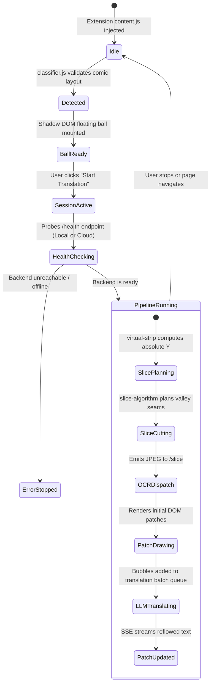
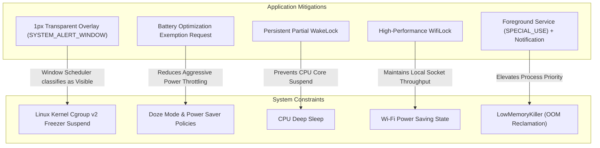

# ComicTranslate: Architecture Design, Algorithms, and Deployment Guide

English | [简体中文](ARCHITECTURE.zh-CN.md)

> **Project Overview**: ComicTranslate is a real-time web comic translation system supporting dual-engine (cloud and edge) execution. It comprises a **Browser Extension (v1.0.4)**, a **Cloud Serverless Microservice (v1.0.0)**, and an **Android Edge OCR Engine (v1.0.3)**.
> This document details the algorithmic designs, pipeline workflows, architectural trade-offs, Android background keep-alive strategies, and complete deployment and usage instructions.

---

## Table of Contents
- [1. System Architecture](#1-system-architecture)
- [2. Key Algorithms and Implementation](#2-key-algorithms-and-implementation)
  - [2.1 Comic Reading Area Classification and LCA Locator (`classifier.js`)](#21-comic-reading-area-classification-and-lca-locator-classifierjs)
  - [2.2 Virtual Strip Unified Coordinate System (`virtual-strip.js`)](#22-virtual-strip-unified-coordinate-system-virtual-stripjs)
  - [2.3 Adaptive Valley Seam Slicing & Text Protection (`slice-algorithm.js`)](#23-adaptive-valley-seam-slicing--text-protection-slice-algorithmjs)
  - [2.4 Declarative Net Request for Cross-Origin Canvas Tainting (`rules.json`)](#24-declarative-net-request-for-cross-origin-canvas-tainting-rulesjson)
  - [2.5 Bitmap Streaming Sliding Window and GPU Memory Management (`pixel-provider.js`)](#25-bitmap-streaming-sliding-window-and-gpu-memory-management-pixel-providerjs)
  - [2.6 Native DOM Dynamic Sentinel Observation (`capture-flow.js`)](#26-native-dom-dynamic-sentinel-observation-capture-flowjs)
  - [2.7 Horizontal Text Box Merging (`merge_horizontal_boxes`)](#27-horizontal-text-box-merging-merge_horizontal_boxes)
  - [2.8 Topological Clustering and Bubble Styling (`clustering` / `styling`)](#28-topological-clustering-and-bubble-styling-clustering--styling)
- [3. Browser Extension Workflow](#3-browser-extension-workflow)
  - [3.1 Lifecycle and State Transitions](#31-lifecycle-and-state-transitions)
  - [3.2 Dual-Channel Network Dispatch (PNA Restriction Handling)](#32-dual-channel-network-dispatch-pna-restriction-handling)
  - [3.3 Stream Translation Pipeline and Adaptive Batching](#33-stream-translation-pipeline-and-adaptive-batching)
- [4. Cloud Backend Architecture (FastAPI + ONNX Runtime)](#4-cloud-backend-architecture-fastapi--onnx-runtime)
  - [4.1 Stateless and In-Memory Decoding](#41-stateless-and-in-memory-decoding)
  - [4.2 Model Pool Warmup and Threading Strategy](#42-model-pool-warmup-and-threading-strategy)
- [5. Mobile Engine Architecture and Keep-Alive Strategies (Android)](#5-mobile-engine-architecture-and-keep-alive-strategies-android)
  - [5.1 Ktor CIO Localhost Network Stack](#51-ktor-cio-localhost-network-stack)
  - [5.2 JNI and ncnn Vulkan Heterogeneous Computing](#52-jni-and-ncnn-vulkan-heterogeneous-computing)
  - [5.3 Background Keep-Alive Analysis and Cgroup Freezer Mitigation](#53-background-keep-alive-analysis-and-cgroup-freezer-mitigation)
- [6. Comparison Between Cloud and Mobile OCR](#6-comparison-between-cloud-and-mobile-ocr)
- [7. Deployment Guide](#7-deployment-guide)
  - [7.1 Cloud Microservice Deployment (Docker / Python)](#71-cloud-microservice-deployment-docker--python)
  - [7.2 Android App Build and Installation](#72-android-app-build-and-installation)
  - [7.3 Browser Extension Installation (Desktop & Mobile)](#73-browser-extension-installation-desktop--mobile)
- [8. Usage Guide](#8-usage-guide)
  - [8.1 Quick Start Steps](#81-quick-start-steps)
  - [8.2 LLM Translation Configuration](#82-llm-translation-configuration)
  - [8.3 Frequently Asked Questions (FAQ)](#83-frequently-asked-questions-faq)

---

## 1. System Architecture

ComicTranslate adopts a decoupled, layered pipeline: **Perception & interaction on the frontend, visual inference on edge/cloud, and semantic translation on LLMs**.

```mermaid
flowchart TD
    subgraph Frontend ["Frontend Environment (Chrome / Kiwi / Lemur Extension)"]
        DOM["Web DOM / Image Detection"] --> Classifier["1. Comic Layout Classifier (Geometric Heuristics)"]
        Classifier --> Locator["2. Container Locator & Anchor Detection (LCA Algorithm)"]
        Locator --> VirtualStrip["3. Virtual Strip Coordinate Mapping"]
        VirtualStrip --> Slicer["4. Adaptive Valley Seam Slicing (Text Protection)"]
        Slicer --> Router{"Network Routing"}
        Router -->|"Local Mode (127.0.0.1:8080)"| NetBridge["Extension Background Relay (PNA Bypass)"]
        Router -->|"Cloud Mode (HTTPS)"| CloudAPI["Direct Fetch API"]
        
        PatchRenderer["DOM Native Patch Renderer"] <-- RecJSON["Bubble Coordinates, Text & Styles"]
        PatchRenderer --> LLMClient["Streaming Translation Dispatcher (First-Slice Eager + Queue)"]
        LLMClient -.->|"Per-Line Parsing"| PatchUpdater["Dynamic Font & Layout Reflow"]
    end

    subgraph MobileEngine ["Mode A: Mobile Local Engine (ComicOCR Android App)"]
        NetBridge --> Ktor["Ktor CIO Async Server (:8080)"]
        Ktor --> Mutex["Coroutine Mutex (GPU Command Serialization)"]
        Mutex --> JNI["JNI / C++20 Native Layer"]
        JNI --> NCNN["ncnn Vulkan GPU Inference (FP16 Mixed Precision)"]
        JNI --> BubbleCpp["Box Merging & Bubble Clustering & Quantization"]
        BubbleCpp --> RecJSON
        
        KeepAliveLayer["Overlay Window & System Locks (Anti-Freeze Matrix)"] -.-> MobileEngine
    end

    subgraph CloudOCR ["Mode B: Cloud Microservice (Docker / Serverless)"]
        CloudAPI --> FastAPISrv["FastAPI + In-Memory Decoding (Zero Disk I/O)"]
        FastAPISrv --> ONNX["ONNX Runtime + RapidOCR"]
        FastAPISrv --> MergePy["Horizontal Merging & Containment Suppression"]
        MergePy --> BFSPy["BFS Graph Clustering & Border Ring Sampling"]
        BFSPy --> RecJSON
    end

    subgraph LLMCloud ["Large Language Model Services (DeepSeek / OpenAI Compatible)"]
        LLMClient <==>|"SSE Streaming Connection"| LLMCloud
    end
```

---

## 2. Key Algorithms and Implementation

### 2.1 Comic Reading Area Classification and LCA Locator (`classifier.js`)
* **Objective**: Automatically recognize vertical web comic layout structures without hardcoded domain lists, distinguishing comic strips from illustrations, news articles, and e-commerce feeds.
* **Mechanism**:
  1. **Dimension Filtering**: Removes icons, avatars, and hidden elements (`display: none`, `opacity: 0`, or area $< 16,000\,\text{px}^2$).
  2. **Single-Column Cluster Assembly (`sameColumn`)**:
     - Width consistency: $\min(W_1, W_2) / \max(W_1, W_2) \ge 0.78$;
     - Center alignment tolerance: $|\text{center}_1 - \text{center}_2| \le \max(40, 0.12W)$;
     - Vertical distance bounds: Allows normal comic panel margins while eliminating disjointed blocks.
  3. **Lowest Common Ancestor (LCA) Convergence**: Calculates the lowest common ancestor node for all matched images. Traversal halts once the candidate container contains $\ge 2$ valid comic images to avoid bubbling up to global parent wrappers that encompass comments (`.comment`) or navigation menus.

### 2.2 Virtual Strip Unified Coordinate System (`virtual-strip.js`)
* **Objective**: Web comics consist of dozens of separate `` tags. Stitching them into a single massive canvas triggers out-of-memory (OOM) browser crashes on mobile devices.
* **Mechanism**:
  - Implements a pure mathematical mapping layer. Normalizes image heights to a standardized working width $W$, generating a monotonic virtual absolute vertical axis $[0, H_{total}]$.
  - Provides bidirectional coordinate transformations:
    $$\text{Global Y} \xleftrightarrow{\text{overlaps / restoreBox / projectBox}} \text{Page Slice Local Y}$$
  - Slices can seamlessly span across physical image boundaries, and recognized text bounding boxes can be accurately mapped back to the relative coordinates of individual DOM images.

### 2.3 Adaptive Valley Seam Slicing & Text Protection (`slice-algorithm.js`)
* **Objective**: Fixed-height slicing frequently splits speech balloons in half, corrupting OCR text and destroying context.
* **Mechanism**:
  1. **Text Protection Zones**: Executes Otsu binarization and 8-connected component analysis within the planning window. Merges connected components into forbidden cutting zones based on stroke fill ratios and character height distributions.
  2. **Horizontal Projection Energy Valleys**: Scans row-by-row pixel variance and edge gradients to locate uniform background gaps.
  3. **Cost Function Optimization**:
     $$Cost(y) = \alpha \cdot \text{Distance}(y, Y_{target}) + \beta \cdot \text{ValleyEnergy}(y) + \gamma \cdot \text{TextZonePenalty}(y)$$
     Searches for the global minimum cost seam near the target height $3.46W$. If no distinct white gap is found across busy artwork, it falls back to a Safe Interval strategy, locating gaps between bounding boxes.

### 2.4 Declarative Net Request for Cross-Origin Canvas Tainting (`rules.json`)
* **Objective**: Third-party comic CDNs enforce cross-origin policies (CORS). Direct canvas pixel inspection triggers browser `Tainted canvas` security exceptions.
* **Mechanism**:
  Leverages the Chrome Extension Declarative Net Request (DNR) API to transparently intercept image resource responses at the network layer and inject permissive headers:
  ```json
  "responseHeaders": [{ "header": "Access-Control-Allow-Origin", "operation": "set", "value": "*" }]
  ```
  Combined with `image.crossOrigin = "anonymous"` on the client, canvas elements can read pixel data without requiring an external proxy server.

### 2.5 Bitmap Streaming Sliding Window and GPU Memory Management (`pixel-provider.js`)
* Utilizes asynchronous, multi-threaded `createImageBitmap` rather than main-thread synchronous `drawImage`.
* Maintains a bounded LRU bitmap cache (default capacity: 3). As the slicing frontier advances, expired bitmaps are explicitly released via `bitmap.close()`, preserving stable GPU memory consumption on mobile browsers.

### 2.6 Native DOM Dynamic Sentinel Observation (`capture-flow.js`)
* Mounts an `IntersectionObserver` onto the penultimate ready image of the current batch (`readyImages[N - 2].img`) with an `800px` root margin.
* Dynamically advances the sentinel as the user scrolls. Slicing halts immediately upon encountering an unready lazy-loaded image to preserve page monotonicity, and periodically calls `yieldToMainThread()` to prevent frame drops during touch scrolling.

### 2.7 Horizontal Text Box Merging (`merge_horizontal_boxes`)
* **Objective**: DBNet text detection often splits words with loose kerning or thin strokes (common in Korean Hangul and English dialogue) into multiple fragmented boxes.
* **Mechanism**: Merges adjacent candidate boxes prior to recognition:
  - Vertical overlap ratio $\ge 0.50$;
  - Horizontal gap $\le 1.5 \times \text{Average Height}$;
  - Height difference ratio $\le 1.8$.
* Feeds merged text lines into recognition, preserving full linguistic context and reducing character truncation.

### 2.8 Topological Clustering and Bubble Styling (`clustering` / `styling`)
* **BFS Bubble Clustering**: Constructs a geometric adjacency graph based on vertical line gaps, horizontal alignment offsets, and font size ratios. Runs Breadth-First Search (BFS) to aggregate individual lines into coherent speech balloons.
* **Style Extraction**: Samples histograms along the outer border ring of text bounding boxes to extract background color (`bg_hex`) and foreground text color (`fg_hex`). Infers font weights (regular 400 vs. bold 700+) using stroke fill ratios.

---

## 3. Browser Extension Workflow

### 3.1 Lifecycle and State Transitions



### 3.2 Dual-Channel Network Dispatch (PNA Restriction Handling)
Modern Chromium browsers restrict public web pages from sending direct `fetch` requests to local private network addresses (`http://127.0.0.1`) under Private Network Access (PNA) specifications.
The extension implements a dual-path dispatch architecture:
* **Cloud Mode**: The content script issues standard `fetch` requests directly to public HTTPS APIs.
* **Local Mode**: The content script packages slice payloads and delegates them via `chrome.runtime.sendMessage` to the extension Service Worker (`background.js`). Operating within privileged extension network boundaries, the background worker invokes `http://127.0.0.1:8080`, bypassing page-level PNA restrictions.

### 3.3 Stream Translation Pipeline and Adaptive Batching
* **First-Slice Eager Dispatch**: Slice 0 triggers an immediate LLM request as soon as its OCR finishes, minimizing initial time-to-first-token (TTFT).
* **Adaptive Batch Bucket**: Subsequent bubbles enter a queue that dispatches whenever:
  1. The queue reaches **14 bubbles** (balancing prompt context length and response latency);
  2. The terminal slice of the chapter is reached;
  3. A quiet duration of **800 ms** elapses.
* **SSE Stream Reflow**: The LLM streams structured lines (e.g., `[S0_B1] Translated text`) via Server-Sent Events (SSE). The frontend regex parser decodes each completed segment and updates the corresponding DOM patch in real time.

---

## 4. Cloud Backend Architecture (FastAPI + ONNX Runtime)

The cloud backend is designed for high-concurrency, stateless execution suitable for container platforms (Docker / Serverless).

### 4.1 Stateless and In-Memory Decoding
* Ingests binary slice images via `multipart/form-data`.
* Directly decodes byte buffers into BGR OpenCV matrices using `np.frombuffer` and `cv2.imdecode` in RAM, completely bypassing disk storage.

### 4.2 Model Pool Warmup and Threading Strategy
* Preloads core language models (Korean, English, Japanese, Russian) during the FastAPI `lifespan` startup phase to eliminate first-request cold starts.
* Restricts OpenCV internal threads to 1 (`cv2.setNumThreads(1)`) to avoid CPU context-switching contention between OpenCV operations and ONNX Runtime thread pools under concurrent traffic.
* Uses vectorized batch inference (`rec_batch_num = 16`) to saturate CPU AVX2/AVX-512 SIMD pipelines.

---

## 5. Mobile Engine Architecture and Keep-Alive Strategies (Android)

The `ComicOCR` Android application operates as a standalone local inference engine running on the user's mobile device, removing the need for a remote cloud server.

### 5.1 Ktor CIO Localhost Network Stack
* Runs an embedded **Ktor CIO (Coroutine I/O)** HTTP server inside an Android background service.
* Binds to `127.0.0.1:8080`, exposing `/health`, `/slice`, and `/api/ocr` endpoints compatible with the cloud schema.

### 5.2 JNI and ncnn Vulkan Heterogeneous Computing
* **Direct JNI Buffer Passing**: Accesses Android Bitmap byte buffers across JVM boundaries into native C++ (`ocr_jni.cpp`) without intermediate copies.
* **Vulkan Hardware Acceleration**:
  Integrates Tencent ncnn optimized for mobile architectures. On supported Adreno and Mali GPUs, it activates Vulkan computation with **FP16 mixed precision**:
  ```cpp
  engine->net.opt.use_vulkan_compute = true;
  engine->net.opt.use_fp16_packed = true;
  engine->net.opt.use_fp16_storage = true;
  engine->net.opt.use_fp16_arithmetic = true;
  ```
  This reduces memory bandwidth consumption by 50% while accelerating inference throughput.
* **GPU Serialization & Lazy Loading**:
  - Preloads DBNet and Korean/English models on boot; Japanese and Russian are loaded lazily upon request.
  - Due to GPU command buffer concurrency limits in certain mobile drivers, native inference calls are serialized using a Kotlin coroutine mutex (`ocrMutex.withLock`).

### 5.3 Background Keep-Alive Analysis and Cgroup Freezer Mitigation

When a user switches from ComicOCR to the mobile browser to read comics, background services are subject to aggressive system power management. Under Android 12+ **Cgroup v2 Freezer** mechanisms, background processes may be put into a `FROZEN` state within seconds, causing local HTTP requests to stall.

To mitigate this behavior, the application applies a multi-layered keep-alive strategy:



#### Key Implementation: 1px Transparent Overlay (`SYSTEM_ALERT_WINDOW`)
* **Principle**: The Android kernel Cgroup Freezer determines whether an application group is eligible for freezing based on whether it maintains an active, visible window on screen.
* **Implementation**:
  With user permission, the service attaches an unobtrusive $1 \times 1$ pixel, translucent ($0.01$ alpha), non-touchable overlay window via `WindowManager`:
  ```kotlin
  val params = WindowManager.LayoutParams(
      1, 1,
      layoutType, // TYPE_APPLICATION_OVERLAY
      WindowManager.LayoutParams.FLAG_NOT_FOCUSABLE or
          WindowManager.LayoutParams.FLAG_NOT_TOUCHABLE or
          WindowManager.LayoutParams.FLAG_LAYOUT_NO_LIMITS,
      PixelFormat.TRANSLUCENT
  ).apply {
      gravity = Gravity.TOP or Gravity.START
      alpha = 0.01f
  }
  windowManager.addView(overlayView, params)
  ```
* **Practical Considerations**: This approach informs the window manager that the app maintains a visible surface, mitigating kernel-level freezing. However, because OEM skins (MIUI/HyperOS, ColorOS, OriginOS) impose custom background restrictions, users must still allow background autostart and battery unmetered execution in system settings for stable performance.

---

## 6. Comparison Between Cloud and Mobile OCR

| Dimension | Cloud Microservice | Mobile Engine (Android) |
| :--- | :--- | :--- |
| **Directory** | `app/` | `android/` |
| **Runtime** | Python 3.10+ / Linux Container | Android 8.0+ / ART VM |
| **HTTP Stack** | FastAPI + Uvicorn | Ktor CIO Async Embedded Engine |
| **Inference Framework** | RapidOCR + ONNX Runtime (CPU) | Tencent ncnn (C++20 NDK, Vulkan GPU) |
| **Precision** | FP32 / AVX2 Vectorization | **FP16 Mixed Precision** (~50% VRAM saving) |
| **Network Endpoint** | Public HTTPS domain | **Localhost Loopback `127.0.0.1:8080`** |
| **Server Cost** | Cloud hosting or serverless compute fees | **Zero server cost** (Runs on device) |
| **Privacy** | Slices uploaded to external server | **Completely on-device**, offline capability |
| **Process Lifespan** | Managed by container orchestrators | **Foreground Service + Locks + 1px Overlay** |

---

## 7. Deployment Guide

### 7.1 Cloud Microservice Deployment (Docker / Python)

#### Option A: Docker Container (Recommended)
A production-ready `Dockerfile` optimized for headless CPU inference is included in the project root:
```bash
# 1. Build Docker image
docker build -t comic-ocr-server:v1.0 .

# 2. Run container (mapped to host port 8000)
docker run -d \
  --name comic-ocr \
  --restart unless-stopped \
  -p 8000:8000 \
  comic-ocr-server:v1.0

# 3. Verify health
curl http://localhost:8000/health
# Response: {"status":"ok","version":"1.0.0","device":"cpu","loaded_models":["korean","en","japan","cyrillic"]}
```

#### Option B: Standalone Python Environment
```bash
# 1. Set up virtual environment (Python 3.10 or 3.11 recommended)
python3 -m venv venv
source venv/bin/activate  # Windows: .\venv\Scripts\activate

# 2. Install system library (Debian/Ubuntu)
sudo apt-get update && sudo apt-get install -y libglib2.0-0

# 3. Install Python dependencies
pip install --upgrade pip
pip install -r requirements.txt
pip install --no-deps "rapidocr-onnxruntime>=1.3.14"

# 4. Launch server
uvicorn app.main:app --host 0.0.0.0 --port 8000 --workers 1
```

---

### 7.2 Android App Build and Installation

#### Option A: Install Prebuilt APK (End Users)
The repository provides a precompiled APK ready for testing:
- **File**: `ComicOCR-v1.0.3.apk`
- Install the package on any 64-bit (`arm64-v8a`) device running Android 8.0 (API 26) or higher.

#### Option B: Build from Source (Developers)
- **Requirements**:
  - Android Studio (Ladybug / Koala or newer)
  - Android SDK Platform 35
  - Android NDK: `27.1.12297006` (or 25.x+)
  - CMake: `3.22.1`
  - JDK 17
```bash
cd android
./gradlew assembleRelease
# Output artifact: android/app/build/outputs/apk/release/app-release-unsigned.apk
```

---

### 7.3 Browser Extension Installation (Desktop & Mobile)

#### Desktop Installation (Chrome / Edge / Brave)
Desktop installations fully support using either the packaged ZIP file or the source folder:
* **Option A (ZIP Package)**: Extract `comic-translate-plugin-v1.0.4.zip` into any directory;
* **Option B (Source Directory)**: Locate the [`plugin/`](file:///plugin/) directory directly;
1. Navigate to the extension manager (`chrome://extensions/`);
2. Enable **Developer mode** in the upper-right corner;
3. Click **Load unpacked** and select the extracted folder or `plugin/` directory (or drag-and-drop the zip into compatible Chromium browsers).

#### Mobile Installation (Lemur Browser / Kiwi Browser)
To run extensions on Android devices:
1. Install **Lemur Browser** or **Kiwi Browser** from the app store;
2. Navigate to the browser's Extension Management page and enable Developer mode;
3. Choose "Load unpacked extension" or import the packaged archive `comic-translate-plugin-v1.0.4.zip`.

---

### 7.4 Local Visual Algorithm Playground
For developers or users who need to calibrate OCR geometry and text clustering parameters offline:
- **Startup Script**: Double-click **`启动算法演练台.bat`** in the project root;
- **Browser Endpoint**: Opens automatically at `http://127.0.0.1:9000/playground`;
- **Capabilities**:
  - Upload arbitrary comic panels or vertical slices;
  - Real-time parameter tweaking via 10+ sliders: `det_box_thresh`, `det_unclip_ratio`, `sfx_height_ratio`, `vertical_gap_ratio`, etc.;
  - Visual diagnostics displaying binary masks, DBNet polygon contours, horizontal merging, and topological BFS bubble clusters.

---

## 8. Usage Guide

### 8.1 Floating Ball Gestures and Core Interactions

Anchored to the top-left corner of the comic reading area, the floating ball adheres to the principle of **"Single-tap for immediate action, Long-press for deep configuration"**:

* **🔘 Single-Tap / Short Click**:
  - **When the menu is closed**: Instantly **starts or stops** the translation pipeline with a single click (no need to open the menu);
  - **When the menu is open**: Dismisses the menu immediately.
* **👆 Long-Press (Hold for 0.5s)**:
  - At any time, long-pressing the ball **opens or closes** the quick configuration drawer (languages, sensitivity presets, advanced modal).

---

### 8.2 Visual Pipeline Effects After Startup

Once started, the system delivers immediate and seamless visual feedback:

1. **Floating Ball State Transitions**:
   - The ball switches from standby to a **spinning halo and breathing glow**, signaling active processing;
   - Once the initial viewport translation completes, the ball enters an **unobtrusive stealth mode** (partially transparent to avoid obstructing artwork);
   - Hovering or touching the ball temporarily restores full opacity.
2. **Page-Level Canvas Overlay**:
   - **Native DOM Masking**: Speech balloons are immediately covered by color-matched blanking patches upon detection, concealing foreign text;
   - **Typewriter Text Reflow**: As streaming LLM tokens arrive, translated text types dynamically into balloons with automatic font scaling;
   - **Source/Translation Toggle**: Readers can **click on any patch** to toggle between the translated text and the original foreign speech bubble.

---

### 8.3 Launching Diagnostics & Dev HUD (Two Methods)

#### Method 1: In-Page Dev HUD Dashboard
To monitor slice latency, OCR inference time, and LLM TTFT during active reading:
1. **Long-press the floating ball** (0.5s), then click **"⚙️ More Settings"**;
2. Open the advanced accordion and locate the **"Dev HUD Dashboard"** card;
3. Click **"🚀 Launch HUD"**:
   - A diagnostic window docks in the upper-right corner, displaying live FPS, slice duration, OCR inference latency, TTFT, and memory consumption;
4. You can also enable the **"Slice Guide & Seam Preview"** toggle to visualize algorithm cutting lines and bounding protection zones directly on the comic.

#### Method 2: Offline Algorithm Playground
For offline slice parameter calibration:
1. Double-click **`启动算法演练台.bat`**;
2. Visit `http://127.0.0.1:9000/playground` to inspect polygon contours, binarization masks, and graph clustering.

---

### 8.4 Quick Start Operation Steps

```text
[Start OCR Backend] ---> [Open Web Comic] ---> [Long-Press Ball to Configure] ---> [Single-Tap Ball to Start]
```

1. **Start the OCR Service**:
   - **For Mobile Mode**: Open **ComicOCR** on your phone, tap `▶ START SERVICE`. The status indicator turns green: `ONLINE (127.0.0.1:8080)`.
   - **For Cloud Mode**: Verify that your Docker container or remote API server is running.
2. **Open Comic Page**:
   - Navigate to any web comic chapter page in your browser.
   - The classifier detects the layout automatically, displaying a floating control ball near the top-left of the first panel.
3. **Configure Settings**:
   - **Long-press the floating ball (0.5s)** to open the menu.
   - **Backend Route**: Select `Localhost (127.0.0.1:8080)` or input your `Cloud API Endpoint`.
   - **Language**: Select the source language (Korean / English / Japanese / Russian).
   - **LLM Configuration**: Enter your OpenAI-compatible API credentials.
4. **Start Translating**:
   - **Single-tap the floating ball** to initiate translation instantly.
   - As you scroll, the page automatically slices panels, runs OCR, and overlays translated text directly onto speech balloons.

---

### 8.2 LLM Translation Configuration

The extension integrates an OpenAI-compatible translation client. Recommended configurations:
* **API Base URL**: The endpoint for your LLM provider (e.g., `https://api.deepseek.com/v1` or `https://api.siliconflow.cn/v1`);
* **API Key**: Your API authentication key;
* **Model Name**: e.g., `deepseek-chat`, `gpt-4o-mini`, or `Qwen/Qwen2.5-7B-Instruct`;
* **Connectivity Test**: Tap "Test Connection" inside the settings panel to confirm configuration validity.

---

### 8.3 Frequently Asked Questions (FAQ)

#### Q1: On Android, OCR stalls or times out after switching to the browser.
* **A**: This is caused by OEM background battery throttling. Verify the following:
  1. On the ComicOCR home screen, tap **"🪟 Anti-Freeze Overlay"** and grant **"Display over other apps"** permission;
  2. Tap **"🔋 Battery Whitelist"** and set the application to **"Unrestricted"**;
  3. In system settings, allow background autostart and lock ComicOCR in the recent apps task switcher.

#### Q2: The web comic is visible, but the floating ball does not appear.
* **A**:
  1. Wait for images to load (the classifier waits until the first batch of images resolves their dimensions);
  2. If the website embeds images inside nested `iframes` or closed `Shadow DOMs`, open the extension popup and click "Force Trigger";
  3. Check the developer console for page-level script errors blocking DOM events.

#### Q3: Why is Korean OCR slightly slower than English on mobile devices?
* **A**: The Korean OCR dictionary contains over 11,000 Hangul and alphanumeric characters, requiring significantly larger linear projections and CTC beam traversals than the 436-character English dictionary. For English-only comics, manually selecting **"English (en)"** in settings reduces latency substantially.
