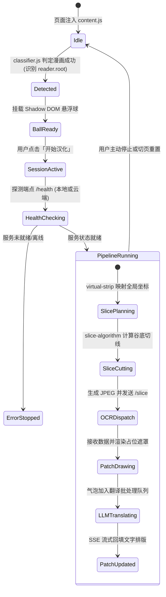

# ComicTranslate：系统架构设计、算法实现与工程部署指南

[English Version](ARCHITECTURE.en.md) | 简体中文

> **项目定位**：ComicTranslate 是一套面向长条漫画阅读的端云双擎实时翻译系统。系统包含**浏览器扩展前端（v1.0.4）**、**云端 Serverless 微服务（v1.0.0）**与 **Android 本地边缘 OCR 引擎（v1.0.3）**。
> 本文系统性阐述项目的算法设计、各端工作流程、技术选型权衡、移动端后台运行机制，以及完整的部署与使用说明。

---

## 目录
- [一、 系统整体架构](#一-系统整体架构)
- [二、 核心算法设计与实现](#二-核心算法设计与实现)
  - [1. 漫画阅读区智能分类与容器收敛 (`classifier.js`)](#1-漫画阅读区智能分类与容器收敛-classifierjs)
  - [2. 虚拟长卷统一坐标系 (`virtual-strip.js`)](#2-虚拟长卷统一坐标系-virtual-stripjs)
  - [3. 自适应能量谷底切片与文字保护区 (`slice-algorithm.js`)](#3-自适应能量谷底切片与文字保护区-slice-algorithmjs)
  - [4. DNR 声明式规则处理跨域画布污染 (`rules.json`)](#4-dnr-声明式规则处理跨域画布污染-rulesjson)
  - [5. 位图流式滑动窗口与显存释放 (`pixel-provider.js`)](#5-位图流式滑动窗口与显存释放-pixel-providerjs)
  - [6. 原生 DOM 动态哨兵观测 (`capture-flow.js`)](#6-原生-dom-动态哨兵观测-capture-flowjs)
  - [7. 同行文本框前置几何融合 (`merge_horizontal_boxes`)](#7-同行文本框前置几何融合-merge_horizontal_boxes)
  - [8. 拓扑聚类与气泡样式提取 (`clustering` / `styling`)](#8-拓扑聚类与气泡样式提取-clustering--styling)
- [三、 浏览器插件工作流程](#三-浏览器插件工作流程)
  - [1. 生命周期与状态机转换](#1-生命周期与状态机转换)
  - [2. 双通道网络调度 (处理浏览器 PNA 限制)](#2-双通道网络调度-处理浏览器-pna-限制)
  - [3. 流式翻译调度与自适应批处理 (LLM Pipeline)](#3-流式翻译调度与自适应批处理-llm-pipeline)
- [四、 云端后端工作原理 (FastAPI + ONNX Runtime)](#四-云端后端工作原理-fastapi--onnx-runtime)
  - [1. 无状态与内存直接解码](#1-无状态与内存直接解码)
  - [2. 引擎预热与线程调度](#2-引擎预热与线程调度)
- [五、 移动端本地引擎工作原理与保活分析 (Android)](#五-移动端本地引擎工作原理与保活分析-android)
  - [1. Ktor CIO 本地回环网络栈](#1-ktor-cio-本地回环网络栈)
  - [2. JNI 与 ncnn Vulkan 异构推理](#2-jni-与-ncnn-vulkan-异构推理)
  - [3. 移动端后台保活机制与 Cgroup Freezer 应对方案](#3-移动端后台保活机制与-cgroup-freezer-应对方案)
- [六、 双端 OCR 特性对比](#六-双端-ocr-特性对比)
- [七、 部署指南](#七-部署指南)
  - [1. 云端微服务部署 (Docker / Python)](#1-云端微服务部署-docker--python)
  - [2. Android 移动端安装与编译](#2-android-移动端安装与编译)
  - [3. 浏览器插件安装 (桌面端与移动端)](#3-浏览器插件安装-桌面端与移动端)
- [八、 使用指南](#八-使用指南)
  - [1. 快速上手步骤](#1-快速上手步骤)
  - [2. 大语言模型 (LLM) 翻译配置](#2-大语言模型-llm-翻译配置)
  - [3. 常见问题排查 (FAQ)](#3-常见问题排查-faq)

---

## 一、 系统整体架构

ComicTranslate 采用分层解耦的流水线设计：**感知与交互在前端、视觉推理在端/云、文本翻译在 LLM**。

```mermaid
flowchart TD
    subgraph Frontend ["前端环境 (Chrome / Kiwi / 狐猴浏览器插件)"]
        DOM["网页 DOM / 图像嗅探"] --> Classifier["1. 漫画特征分类器 (启发式几何特征)"]
        Classifier --> Locator["2. 最小公共容器定位与首图锁定 (LCA 算法)"]
        Locator --> VirtualStrip["3. 虚拟长卷坐标映射 (跨图统一映射)"]
        VirtualStrip --> Slicer["4. 自适应能量谷底切线规划 (文字保护区避障)"]
        Slicer --> Router{"网络路由判定"}
        Router -->|"本地模式 (127.0.0.1:8080)"| NetBridge["扩展后台脚本转发 (处理 PNA 限制)"]
        Router -->|"云端模式 (HTTPS)"| CloudAPI["直接 Fetch 发起请求"]
        
        RecJSON["气泡文本、坐标与样式数据"] --> PatchRenderer["原生 DOM 补丁渲染"]
        PatchRenderer --> LLMClient["流式翻译调度器 (首片优先 + 聚合队列)"]
        LLMClient -.->|"逐行解构回填"| PatchUpdater["动态文字排版重绘"]
    end

    subgraph MobileEngine ["模式 A: 手机本地边缘端 (ComicOCR Android App)"]
        NetBridge --> Ktor["Ktor CIO 异步服务 (:8080)"]
        Ktor --> Mutex["协程互斥锁 (GPU 命令串行化)"]
        Mutex --> JNI["JNI / C++20 原生层"]
        JNI --> NCNN["ncnn Vulkan GPU 推理 (FP16 混合精度)"]
        JNI --> BubbleCpp["同行融合 & 气泡聚类 & 取色"]
        BubbleCpp --> RecJSON
        
        KeepAliveLayer["透明悬浮窗与系统锁 (后台防冻结机制)"] -.-> MobileEngine
    end

    subgraph CloudOCR ["模式 B: 云端微服务 (Docker / Serverless)"]
        CloudAPI --> FastAPISrv["FastAPI + 内存解码 (免磁盘 I/O)"]
        FastAPISrv --> ONNX["ONNX Runtime + RapidOCR"]
        FastAPISrv --> MergePy["同行前置融合 & 嵌套抑制"]
        MergePy --> BFSPy["BFS 连通图气泡聚类 & 边界环取色"]
        BFSPy --> RecJSON
    end

    subgraph LLMCloud ["大语言模型服务 (DeepSeek / OpenAI 兼容接口)"]
        LLMClient ==>|"SSE 长连接流式传输"| LLMCloud
    end
```

---

## 二、 核心算法设计与实现

### 1. 漫画阅读区智能分类与容器收敛 (`classifier.js`)
* **设计目的**：在不依赖针对特定网站编写适配规则的前提下，通过页面几何特征自适应识别长条漫画阅读区，排除插画、新闻文章与电商列表。
* **实现逻辑**：
  1. **尺寸初筛**：过滤图标、头像、广告与不可见元素（`display: none`、`opacity: 0`、宽高过小或单图面积 $< 16,000\,\text{px}^2$）。
  2. **同列相邻切片聚合（`sameColumn`）**：
     - 宽度一致性：$\min(W_1, W_2) / \max(W_1, W_2) \ge 0.78$；
     - 水平中心对齐容差：$|\text{center}_1 - \text{center}_2| \le \max(40, 0.12W)$；
     - 垂直间距合理性：限定两图间隙范围，允许分镜留白，过滤纵向脱节内容。
  3. **最小公共祖先（LCA）收敛**：计算同列切片的最低公共祖先容器。若该容器已包含 $\ge 2$ 张有效大图，则停止向上冒泡，避免将外部评论区（`.comment`）或导航栏包裹进阅读区。

### 2. 虚拟长卷统一坐标系 (`virtual-strip.js`)
* **设计目的**：长条漫由多张独立的 `` 拼接而成。若将几十张大图拼接到单一 Canvas，移动端浏览器极易发生显存溢出（OOM）。
* **实现逻辑**：
  - 构建无物理像素开销的数学映射层。以标准工作宽度 $W$ 为基准，按比例换算每张原图的高度，在逻辑轴上累加形成全局绝对纵坐标 $[0, H_{total}]$。
  - 提供全局坐标与局部坐标的双向映射接口：
    $$\text{Global Y} \xleftrightarrow{\text{overlaps / restoreBox / projectBox}} \text{Page Slice Local Y}$$
  - 切片可以跨越原图物理接缝，切片完成后又能精准将识别框还原到具体 DOM 节点的相对位置。

### 3. 自适应能量谷底切片与文字保护区 (`slice-algorithm.js`)
* **设计目的**：固定高度切片容易从对话气泡中间斩断文字，导致 OCR 识别乱码及上下文丢失。
* **实现逻辑**：
  1. **文字保护区（Text Protection Zones）**：对规划窗口内的像素执行 Otsu 二值化与八邻域连通域分析（Connected Components），结合笔画填充率与字高分布提取文字行，标记为禁切保护区。
  2. **水平投影能量谷底（Horizontal Projection Profile）**：逐行统计图像边缘能量与灰度方差，定位背景留白带。
  3. **动态规划代价选线**：
     $$Cost(y) = \alpha \cdot \text{Distance}(y, Y_{target}) + \beta \cdot \text{ValleyEnergy}(y) + \gamma \cdot \text{TextZonePenalty}(y)$$
     在 $3.46W$ 目标高度附近搜索全局代价最低的切线。若整屏为复杂背景无明显留白，则启用安全区间回退（Safe Interval Fallback），在连通域间隙中选线。

### 4. DNR 声明式规则处理跨域画布污染 (`rules.json`)
* **设计目的**：第三方漫画 CDN 图片存在同源策略限制，直接使用 Canvas 提取像素会触发浏览器 `Tainted canvas` 跨域安全报错。
* **实现逻辑**：
  使用 Chrome Extension 提供的 Declarative Net Request (DNR) 机制，在网络层拦截图片资源请求并添加允许跨域的响应头：
  ```json
  "responseHeaders": [{ "header": "Access-Control-Allow-Origin", "operation": "set", "value": "*" }]
  ```
  结合前端配置 `image.crossOrigin = "anonymous"`，使 Canvas 能够正常读取像素数据，无需架设额外的图片反向代理服务。

### 5. 位图流式滑动窗口与显存释放 (`pixel-provider.js`)
* 采用浏览器多线程异步解码接口 `createImageBitmap` 替代主线程同步的 `drawImage`。
* 维护容量为 3 的 LRU 位图缓存池。切片窗口向前滑动后，不再使用的历史位图显式调用 `bitmap.close()` 释放 GPU 显存，维持平稳的内存水位。

### 6. 原生 DOM 动态哨兵观测 (`capture-flow.js`)
* 将 `IntersectionObserver` 挂载在当前已就绪批次的倒数第二张原生图片（`readyImages[N - 2].img`）上，配置 `800px` 底部视距。
* 随用户滚动动态向前迁移哨兵；探测到未就绪的懒加载图片时主动截断切片推进，保障页序单调递增；并在切图循环中通过 `yieldToMainThread()` 让渡微任务，防止阻塞页面渲染线程。

### 7. 同行文本框前置几何融合 (`merge_horizontal_boxes`)
* **设计目的**：针对字间距较宽或细长笔画的文字（如韩文、英文），检测网络可能将一行文本识别为多个离散碎片。
* **实现逻辑**：在送入识别网络（REC）前执行几何合并：
  - 垂直方向投影重叠率 $\ge 0.50$；
  - 水平方向间距 $\le 1.5$ 倍平均字高；
  - 字高差异比例 $\le 1.8$。
* 融合后的完整行送入识别，显著提升序列识别准确率并保留了句式完整度。

### 8. 拓扑聚类与气泡样式提取 (`clustering` / `styling`)
* **BFS 气泡聚类**：依据行间距、中心对齐偏移与字号相似度构建空间几何图，使用广度优先搜索（BFS）将多行文本聚合成段落气泡。
* **样式提取**：在文本框外侧边界环采样像素直方图，计算背景色（`bg_hex`）与文本颜色（`fg_hex`）；基于笔画填充率推断字体粗细（常规 400 与粗体 700+）。

---

## 三、 浏览器插件工作流程

### 1. 生命周期与状态机转换



### 2. 双通道网络调度 (处理浏览器 PNA 限制)
现代浏览器对网页向本地私有网络（`http://127.0.0.1`）发起请求有严格的私有网络访问（PNA）拦截。插件设计了自适应网络分发链路：
* **云端模式**：内容脚本直接调用公共 HTTPS 接口。
* **本地模式**：内容脚本通过内部消息将图像数据发送至扩展后台服务（`background.js` Service Worker），由扩展上下文直接请求本地 `http://127.0.0.1:8080`，避开网页直接访问本地私有网络的限制。

### 3. 流式翻译调度与自适应批处理 (LLM Pipeline)
* **首片优先**：第 0 号切片识别完成后立即触发独立的首次 LLM 请求，缩短首屏出词等待时间。
* **自适应聚合桶**：后续气泡进入缓冲队列，满足以下任一条件时触发批量翻译：
  1. 队列累积达到 **14 个气泡**；
  2. 探测到最后一批切片（章节结束）；
  3. 缓冲静默等待超时达 **800 ms**。
* **SSE 流式回填**：LLM 接口通过服务端推送事件（SSE）以标记格式（如 `[S0_B1] 译文`）逐步返回，前端解析后实时更新对应 DOM 补丁中的文本内容。

---

## 四、 云端后端工作原理 (FastAPI + ONNX Runtime)

云端服务针对高并发与容器化（Docker / Serverless）场景进行轻量化设计。

### 1. 无状态与内存直接解码
* 服务端接收 `multipart/form-data` 二进制切片文件流。
* 通过 `np.frombuffer` 结合 `cv2.imdecode` 在系统内存中直接解码为 BGR 图像矩阵，处理过程不依赖本地磁盘持久化，消除磁盘 I/O 开销。

### 2. 引擎预热与线程调度
* 在 FastAPI 的 `lifespan` 阶段预热加载核心语种模型（韩/英/日/俄），避免生产环境首个请求产生冷启动延迟。
* 将 OpenCV 内部线程数设为 1（`cv2.setNumThreads(1)`），避免多切片并发请求时与 ONNX Runtime 的算子线程产生 CPU 调度竞争。
* 识别阶段设定批处理大小（`rec_batch_num = 16`），提升向量化运算吞吐量。

---

## 五、 移动端本地引擎工作原理与保活分析 (Android)

Android 端的 `ComicOCR` 应用旨在将推理能力下沉至移动设备，提供无需公网服务器的本地化方案。

### 1. Ktor CIO 本地回环网络栈
* 运行在原生 Android 服务（Service）内部，采用轻量级 **Ktor CIO (Coroutine I/O)** 异步网络引擎。
* 监听本地回环地址 `127.0.0.1:8080`，提供与云端格式对齐的 `/health`、`/slice` 和 `/api/ocr` 接口。

### 2. JNI 与 ncnn Vulkan 异构推理
* **内存直通**：通过 JNI 接口跨越 JVM 边界，将 Android Bitmap 像素缓冲区传递至 C++ 原生层（`ocr_jni.cpp`）。
* **Vulkan 硬件加速**：
  集成 Tencent ncnn 框架，适配移动端芯片。在支持 Vulkan 的 GPU（高通 Adreno / 联发科 Mali）上开启硬件管线，并开启 **FP16 半精度浮点计算**，降低显存占用与发热。
* **显存命令保护与懒加载**：
  - 启动阶段加载检测器及韩文、英文核心模型；日文、俄文模型采用按需懒加载；
  - 由于部分移动端 GPU 驱动不支持并发命令写入，在 Kotlin 服务层使用协程互斥锁（`ocrMutex.withLock`）对 Native 推理调用进行串行化保护。

### 3. 移动端后台保活机制与 Cgroup Freezer 应对方案

在 Android 系统中，当用户切换至浏览器进行阅读时，后台服务面临系统休眠及内核进程冻结的挑战。特别是在 Android 12+ 引入 **Cgroup v2 Freezer** 机制后，切至后台的应用即使进程未被终止，其 cgroup 也可能在数秒内被置为 `FROZEN` 状态，导致本地 Socket 请求挂起超时。

为提高后台运行稳定性，应用实现了组合防护策略：

```mermaid
flowchart TD
    subgraph SystemThreats ["系统级限制机制"]
        T1["Linux 内核 Cgroup v2 Freezer 挂起进程"]
        T2["Doze 模式与系统省电策略"]
        T3["CPU 深度睡眠休眠 (Sleep)"]
        T4["Wi-Fi 节能休眠"]
        T5["系统 LowMemoryKiller (内存紧张回收)"]
    end

    subgraph Defenses ["应用层应对机制"]
        D1["1px 悬浮透明覆层 (SYSTEM_ALERT_WINDOW)"] -->|窗口调度判定为可见应用| T1
        D2["申请忽略电池优化白名单"] -->|减少系统级节电拦截| T2
        D3["常驻 Partial WakeLock"] -->|维持 CPU 基本工作状态| T3
        D4["高性能 WifiLock"] -->|保持本地网络吞吐| T4
        D5["前台服务声明 (SPECIAL_USE) + 常驻通知"] -->|提升进程优先级 (降低 oom_adj)| T5
    end
```

#### 关键实现：1px 悬浮透明覆层 (`SYSTEM_ALERT_WINDOW`)
* **原理**：Android 系统在判定是否将应用加入 Cgroup Freezer 时，依赖应用是否持有处于可见状态的窗口。
* **实现**：
  在获得用户授权后，后台服务通过 `WindowManager` 添加一个尺寸为 1×1 像素、透明度为 0.01、不可聚焦且不可触摸的覆盖视窗（`TYPE_APPLICATION_OVERLAY`）。
  ```kotlin
  val params = WindowManager.LayoutParams(
      1, 1,
      layoutType,
      WindowManager.LayoutParams.FLAG_NOT_FOCUSABLE or
          WindowManager.LayoutParams.FLAG_NOT_TOUCHABLE or
          WindowManager.LayoutParams.FLAG_LAYOUT_NO_LIMITS,
      PixelFormat.TRANSLUCENT
  ).apply {
      gravity = Gravity.TOP or Gravity.START
      alpha = 0.01f
  }
  windowManager.addView(overlayView, params)
  ```
* **效果与限制**：该方案使系统将该进程视作包含可见窗口的组件，从而降低被内核冻结的概率。但请注意，各手机厂商定制 ROM（如 MIUI/HyperOS、ColorOS）具备差异化的后台管理策略，用户仍需在系统设置中将应用加入自启动和后台无限制白名单以获得最稳定的体验。

---

## 六、 双端 OCR 特性对比

| 维度 | 云端微服务 (Cloud Backend) | 移动端引擎 (ComicOCR Android) |
| :--- | :--- | :--- |
| **代码目录** | `app/` | `android/` |
| **运行时** | Python 3.10+ / Linux 容器 | Android 8.0+ / ART 虚拟机 |
| **HTTP 框架** | FastAPI + Uvicorn | Ktor CIO 异步嵌入式服务 |
| **推理框架** | RapidOCR + ONNX Runtime (CPU) | Tencent ncnn (C++20 NDK, Vulkan GPU) |
| **数据精度** | FP32 / AVX2 向量化 | **FP16 混合精度** (显存节约约 50%) |
| **网络地址** | 公网 HTTPS / 自建服务器域名 | **本机回环 `127.0.0.1:8080`** |
| **服务器成本** | 需维护云服务器或按量 Serverless | **零服务器成本** (算力由用户手机提供) |
| **隐私性** | 切片数据上传至网络服务 | **数据不出手机**，支持完全离线环境 |
| **后台持久化** | 由容器编排/托管平台保障 | **前台服务 + 锁机制 + 1px 悬浮窗缓解冻结** |

---

## 七、 部署指南

### 1. 云端微服务部署 (Docker / Python)

#### 方案 A：Docker 容器化部署（推荐）
项目根目录包含完整的 `Dockerfile`，已配置优化过的纯 CPU 推理环境。
```bash
# 1. 构建镜像
docker build -t comic-ocr-server:v1.0 .

# 2. 启动容器 (映射宿主机 8000 端口)
docker run -d \
  --name comic-ocr \
  --restart unless-stopped \
  -p 8000:8000 \
  comic-ocr-server:v1.0

# 3. 验证服务状态
curl http://localhost:8000/health
# 返回: {"status":"ok","version":"1.0.0","device":"cpu","loaded_models":["korean","en","japan","cyrillic"]}
```

#### 方案 B：直接使用 Python 环境运行
```bash
# 1. 环境准备 (推荐 Python 3.10 或 3.11)
python3 -m venv venv
source venv/bin/activate  # Windows: .\venv\Scripts\activate

# 2. 安装系统依赖 (Debian/Ubuntu)
sudo apt-get update && sudo apt-get install -y libglib2.0-0

# 3. 安装依赖包
pip install --upgrade pip
pip install -r requirements.txt
pip install --no-deps "rapidocr-onnxruntime>=1.3.14"

# 4. 启动服务
uvicorn app.main:app --host 0.0.0.0 --port 8000 --workers 1
```

---

### 2. Android 移动端安装与编译

#### 方式一：直接安装预编译 APK（推荐用户使用）
项目根目录下提供了打包好的应用安装包：
- **安装包路径**：`ComicOCR-v1.0.3.apk`
- 使用数据线或文件传输助手将 APK 安装到支持 64 位（`arm64-v8a`）的 Android 手机上（需 Android 8.0 及以上版本）。

#### 方式二：通过源码编译 APK（面向开发者）
- **开发工具**：Android Studio Ladybug / Koala 或更新版本
- **环境要求**：
  - Android SDK Platform 35
  - Android NDK: `27.1.12297006` (或 25.x+)
  - CMake: `3.22.1`
  - JDK 17
```bash
# 进入 android 目录
cd android

# 执行 Release 构建
./gradlew assembleRelease
# 构建输出路径: android/app/build/outputs/apk/release/app-release-unsigned.apk
```

---

### 3. 浏览器插件安装 (桌面端与移动端)

#### 桌面端安装 (Chrome / Edge / Brave 等 Chromium 浏览器)
桌面端完全支持使用打包好的 ZIP 压缩包或源码目录安装：
* **方式 A（使用 ZIP 包）**：直接解压打包好的 `comic-translate-plugin-v1.0.4.zip` 到任意固定目录；
* **方式 B（使用源码目录）**：直接定位到本项目源码中的 [`plugin/`](file:///plugin/) 目录；
1. 访问浏览器扩展管理页面（Chrome 输入 `chrome://extensions/`）；
2. 开启右上角的 **“开发者模式” (Developer mode)** 开关；
3. 点击 **“加载已解压的扩展程序” (Load unpacked)**，选择上述解压文件夹或 `plugin/` 目录即可完成加载（支持直接拖入部分兼容浏览器）。

#### 移动端安装 (狐猴浏览器 Lemur / Kiwi Browser)
手机端阅读漫画推荐搭配支持 Chrome 扩展的安卓浏览器使用：
1. 在手机上安装 **狐猴浏览器 (Lemur Browser)** 或 **Kiwi Browser**；
2. 打开浏览器的“扩展商店 / 扩展管理”页面，开启开发者模式；
3. 选择“加载已解压的扩展程序”或直接导入打包好的 `comic-translate-plugin-v1.0.4.zip`。

---

### 4. 本地可视化算法演练台 (Algorithm Playground)
针对开发者或需要微调 OCR 几何参数的用户，项目内置了独立的算法可视化演练台：
- **启动方式**：直接双击项目根目录下的 **`启动算法演练台.bat`**；
- **访问入口**：浏览器自动打开 `http://127.0.0.1:9000/playground`；
- **功能特性**：
  - 支持上传任意单页图片或长条漫画切片；
  - 提供 10+ 动态滑动条实时调节：`det_box_thresh`（候选分割门槛）、`det_unclip_ratio`（多边形膨胀率）、`sfx_height_ratio`（拟声词高度保护）、`vertical_gap_ratio`（纵向行间距倍数）等；
  - 实时可视化二值化掩膜、DET 原始检测多边形、同行水平融合过程，以及最终 BFS 气泡拓扑聚类连线。

---

### 1. 悬浮球交互逻辑与核心手势

悬浮球位于漫画阅读区首图左上角（跟随滚动自动吸附），核心交互遵循**“单击极速启停，长按深入配置”**的设计原则：

* **🔘 短按 / 单击**：
  - **当菜单处于关闭状态时**：直接**一键启动 / 停止**汉化流水线（无需反复打开菜单）；
  - **当菜单处于打开状态时**：短按空白处或悬浮球立即收起菜单。
* **👆 长按（按住 0.5 秒）**：
  - 无论何时，长按悬浮球直接**呼出 / 关闭**常用配置菜单（语种选择、OCR 模式、更多设置等）。

---

### 2. 启动汉化后的流水线视觉效果

当用户点击启动汉化后，系统将自动展示一系列流畅的视觉反馈：

1. **悬浮球自身状态迁移**：
   - 悬浮球由静止状态转为**光环微光旋转与呼吸态**，表明后台流水线正在工作；
   - 在首屏内容汉化完成后，悬浮球会自动转入**半透明隐身防遮挡模式**（降低透明度，避免遮挡阅读视线）；
   - 读者鼠标悬停或触碰悬浮球时，会立即临时恢复全不透明。
2. **网页画卷上的实时渲染**：
   - **原生 DOM 遮罩占位**：一旦检测到台词文字，系统会立刻在原图对应位置铺上涂白遮罩补丁（自动匹配气泡背景色），优雅遮挡原始外文；
   - **流式打字机回填**：大模型翻译结果到达时，译文如同打字机一般流式回填进气泡内，字号根据文字框物理空间自适应缩放；
   - **原文 / 译文自由切换**：读者用手指或鼠标**单击任意翻译补丁**，即可在“中文译文”与“原图外语”之间无缝切换对比。

---

### 3. 如何开启调试页面与唤起 Dev (两种途径)

#### 途径一：在漫画页面唤起实时的 Dev HUD 测试看板
若在阅读过程中希望监控切片速度、OCR 耗时与大模型延迟：
1. **长按悬浮球**（0.5秒）呼出菜单，点击底部的 **“⚙️ 更多配置”** 展开设置弹窗；
2. 展开高级选项卡，找到 **“Dev HUD 测试看板”** 卡片；
3. 点击 **“🚀 唤起看板”** 按钮：
   - 页面右上角将立即弹出实时的 Dev HUD 监控窗，实时展示 FPS、单片切图耗时、OCR 推理时间、大模型首字延迟（TTFT）与内存指标；
4. 你还可以在弹窗中开启 **“切片辅助线与切线预览”** 开关，页面将实时绘制红绿相间的算法安全切线与文字保护区包围盒。

#### 途径二：启动本地离线算法演练台 (Algorithm Playground)
若需要针对特定风格的漫画切片进行离线调参、分析文字检测与聚类逻辑：
1. 双击项目根目录下的 **`启动算法演练台.bat`**；
2. 浏览器自动打开 `http://127.0.0.1:9000/playground`；
3. 上传切片图片，通过页面右侧的 10+ 组动态滑动条实时调节阈值，即时查看二值化掩膜与气泡拓扑聚类连线。

---

### 4. 快速上手操作流程

```text
[启动 OCR 引擎] ---> [打开漫画网页] ---> [长按悬浮球配置] ---> [短按悬浮球启动]
```

1. **启动 OCR 引擎**：
   - **手机本地模式**：打开手机上的 **ComicOCR** 应用，点击中间的 `▶ START SERVICE` 按钮，界面状态变为绿色的 `ONLINE (127.0.0.1:8080)`；
   - **云端模式**：确保部署的 Docker 服务或 Serverless 节点处于运行状态。
2. **访问漫画网页**：
   - 打开常用的网页端长条漫阅读页面（如各类韩漫、美漫在线网站）；
   - 页面加载后，插件分类器会自动识别漫画内容，首张漫画左上角将浮现控制悬浮球。
3. **完成初次配置**：
   - **长按悬浮球 0.5 秒**展开菜单；
   - **后端选择**：选择 `本地引擎 (127.0.0.1:8080)` 或填入自定义的 `云端接口地址`；
   - **识别语言**：选择对应的源语言（韩语 / 英语 / 日语 / 俄语）；
   - **翻译配置**：填入可用的大语言模型 API 凭证（见下方配置说明）。
4. **开始汉化**：
   - **短按悬浮球**即可直接一键启动汉化；
   - 随着用户向下滚动浏览，插件将自动完成切片、提交识别，并将译文覆盖在原气泡位置。

---

### 2. 大语言模型 (LLM) 翻译配置

插件内置了兼容 OpenAI 标准接口协议的流式翻译调用器。推荐配置支持流式长连接的高效大模型：

* **API Base URL**：填写大模型服务商的 API 基础端点（如 `https://api.deepseek.com/v1` 或 `https://api.siliconflow.cn/v1`）；
* **API Key**：填入服务商颁发的身份密钥；
* **模型名称 (Model)**：如 `deepseek-chat`、`gpt-4o-mini` 或 `Qwen/Qwen2.5-7B-Instruct` 等；
* **测试连通性**：点击插件面板内的测试按钮，若提示连通成功即可正常使用。

---

### 3. 常见问题排查 (FAQ)

#### Q1: 手机端切换到浏览器后，OCR 经常超时卡住怎么办？
* **A**：这是由于 Android 系统对后台进程的节电优化限制导致的。请执行以下检查：
  1. 在 ComicOCR 应用首页，点击 **“🪟 悬浮防冻结”** 按钮，确保已授予 **“允许显示在其他应用上层”** 权限；
  2. 点击 **“🔋 电池优化白名单”** 按钮，将应用设为 **“无限制”**；
  3. 在手机系统设置的“应用管理”中，将 ComicOCR 的后台自启动与后台运行权限打开，并在任务切换卡片中锁定该应用。

#### Q2: 页面出现漫画，但悬浮球没有自动出现？
* **A**：
  1. 确认页面是否仍在加载（分类器需要等待首批大图尺寸就绪）；
  2. 某些网站采用了复杂的嵌套 `iframe` 或封闭的 `Shadow DOM`，可在插件弹出面板（Popup）中点击“手动强制唤起”；
  3. 检查控制台（Console）中是否有其他脚本报错阻断了 DOM 加载。

#### Q3: 为什么有的切片在本地识别时稍慢？
* **A**：韩文模型因字典包含超 11,000 个字符分支（涵盖常见拼音音节与西文字符集），CTC 解码遍历时间天然长于纯英文模型（436 字符）。若明确阅读纯英文漫画，建议在悬浮球设置中将语种手动切换为 **“英语 (en)”**，可显著提升处理速度。
